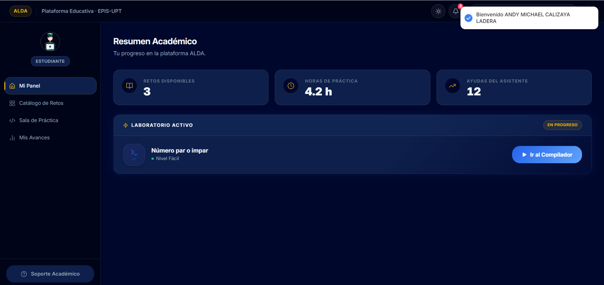

# Pruebas funcionales

> Documento de prueba funcional del caso CP-02. Se conservan los datos, las tablas, los resultados y las capturas de evidencia.

## Caso de prueba CP-02 — Autenticación OAuth

| Campo | Detalle |
|---|---|
| Caso N° | CP-02 |
| Caso de uso | Autenticación OAuth |
| Versión de ejecución | v1.0 |
| Fecha de ejecución | 24/11/2026 |
| Hora de ejecución | 3:00 p.m. |
| Módulo del sistema | Seguridad |

### Descripción de caso

Este caso de prueba verifica el flujo completo de autenticación de un estudiante en la plataforma ALDA. El objetivo es comprobar que al hacer clic en "Iniciar sesión con Google" con una cuenta `@virtual.upt.pe`, el sistema autentique correctamente al usuario vía OAuth2 y lo redirija al dashboard principal mostrando sus datos y las opciones correspondientes a su rol.

### 1. Caso de Prueba

**Tipo de prueba:** Funcional.

#### a. Precondiciones que deben cumplir para realizar la prueba

1. El sistema (plataforma ALDA) debe estar desplegado y accesible desde un navegador web.
2. El estudiante debe contar con una cuenta de Google con dominio `@virtual.upt.pe`.
3. El navegador debe tener JavaScript habilitado y permitir popups de Google.
4. La conexión a internet debe estar activa.
5. La API de Google OAuth debe estar configurada y habilitada en el Backend.
6. El CP-01 (Validación de Dominio) debe haberse ejecutado exitosamente.

#### b. Pasos secuenciales para poder ejecutar

Representa la secuencia de pasos que deberán ser ejecutadas para verificar el caso de Prueba.

##### Flujo Normal: Inicio de sesión exitoso con cuenta institucional

| N° | Pasos | Resultado Esperado |
|---|---|---|
| 1 | Abrir el navegador e ingresar a la URL de la plataforma ALDA. | El sistema muestra la landing page con el título "Aprende a programar razonando" y los botones "Comenzar Ahora" e "Ingresar". |
| 2 | Hacer clic en el botón "Comenzar Ahora" o "Ingresar" en la barra superior. | El sistema redirige a la página de autenticación (`/auth`) mostrando el logo de ALDA, el título "Acceso a la Plataforma", el botón "Iniciar sesión con Google" y el aviso: "Solo los correos @virtual.upt.pe o correos autorizados por administración pueden acceder a ALDA." |
| 3 | Hacer clic en el botón "Iniciar sesión con Google". Se abre el popup de selección de cuenta de Google. Seleccionar la cuenta con dominio `@virtual.upt.pe`. | El popup de Google muestra las cuentas disponibles. Al seleccionar la cuenta institucional, el sistema muestra brevemente "Conectando al servidor..." con un spinner de carga. |
| 4 | Esperar la autenticación y redirección automática. | El sistema autentica exitosamente al usuario, muestra un toast verde con el mensaje "Bienvenido {nombre del estudiante}" y redirige al dashboard principal (`/dashboard`). El dashboard muestra el menú lateral con las opciones: "Mi Panel", "Catálogo de Retos", "Sala de Práctica" y "Mis Avances". En la esquina superior derecha se muestra el nombre y avatar del estudiante. |

**Evidencia del flujo normal:**

##### Flujo Alternativo: Popup de Google cancelado

| N° | Pasos | Resultado Esperado |
|---|---|---|
| 1 | En la página de login, hacer clic en "Iniciar sesión con Google" y cerrar el popup de Google sin seleccionar ninguna cuenta. | El sistema muestra un toast de error "Inicio de sesión cancelado" y el mensaje "La ventana de Google se cerró o falló. Inténtalo de nuevo." El usuario permanece en la página de login. |

#### c. Post condiciones que deben cumplirse para la realización de la prueba

- El usuario ha sido autenticado correctamente mediante OAuth2 con su cuenta institucional.
- El sistema ha creado la sesión con cookie httpOnly y redirigido al dashboard principal.
- El menú lateral muestra las opciones correspondientes al rol de estudiante.
- El nombre y avatar del usuario se muestran correctamente en la interfaz.

### 2. RESULTADOS DE LA PRUEBA

| Defectos y desviaciones encontradas en las pruebas | Resultado (marcar x) |
|---|---|
| La prueba se realizó exitosamente sin encontrar algún error o bug durante la ejecución de esta en sus diferentes escenarios. El flujo completo de autenticación OAuth funciona correctamente y redirige al dashboard del estudiante. | **[x] Con éxito** [ ] Paralizada [ ] Suspendida |

### Observaciones generales

Ninguna.

### Responsable de Prueba

**Primer responsable**

- Nombre: Andy Calizaya
- Fecha: 24/11/2026
- Firma:

**Segundo responsable**

- Nombre: Gregory Huanca Merma
- Fecha: 24/11/2026
- Firma:

---
