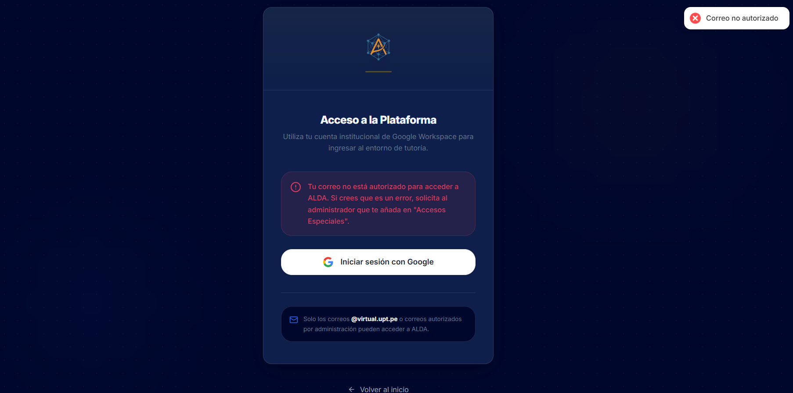

# CASO DE PRUEBA

**Fecha:** 24/11/2026

| Campo | Detalle |
|---|---|
| **Caso de uso** | Autenticación OAuth |
| **Caso N°** | CP-03 |
| **Versión de ejecución** | v1.0 |
| **Fecha de ejecución** | 24/11/2026 – 3:00 p.m. |
| **Módulo del sistema** | Seguridad |
| **Descripción del caso** | Intentar iniciar sesión con una cuenta ajena a @virtual.upt.pe (ej. gmail.com) que no esté en la lista blanca. El sistema debe bloquear el acceso y mostrar un mensaje de error claro en pantalla. |

---

## 7. Caso de Prueba

**Tipo de prueba:** Aceptación

### a. Precondiciones que deben cumplirse para realizar la prueba

- El sistema (plataforma ALDA) debe estar desplegado y accesible desde un navegador web.
- El usuario debe contar con una cuenta de Google con dominio externo (ej. `@gmail.com`, `@hotmail.com`) que **no** esté en la lista blanca del sistema.
- No debe existir una sesión activa en el navegador (cerrar sesión previamente si existe).
- La conexión a internet debe estar activa.

### b. Pasos secuenciales para poder ejecutar

Representa la secuencia de pasos que deberán ser ejecutados para verificar el caso de prueba.

#### Flujo Normal: Bloqueo de acceso con dominio externo

| N° | Pasos | Resultado esperado |
|---|---|---|
| 1 | Abrir el navegador e ingresar a la página de login de ALDA (`/auth`). | El sistema muestra la página de autenticación con el botón "Iniciar sesión con Google" y el aviso: "Solo los correos @virtual.upt.pe o correos autorizados por administración pueden acceder a ALDA." |
| 2 | Hacer clic en "Iniciar sesión con Google" y seleccionar una cuenta con dominio externo (ej. `usuario@gmail.com`) que no esté en la lista blanca. | El popup de Google permite seleccionar la cuenta. El sistema envía el token al Backend para validación. |
| 3 | Verificar que el sistema rechaza el acceso mostrando un mensaje de error claro en la interfaz. | El Backend devuelve HTTP 403 con el mensaje "Solo correos institucionales o autorizados están permitidos." El Frontend muestra un toast rojo "Correo no autorizado" y un recuadro rojo con el texto: "Tu correo no está autorizado para acceder a ALDA. Si crees que es un error, solicita al administrador que te añada en «Accesos Especiales»." El usuario **no** es redirigido al dashboard; permanece en `/auth`. |

#### Flujo Alternativo: Cuenta externa en lista blanca

| N° | Pasos | Resultado esperado |
|---|---|---|
| 1 | Si un administrador agrega previamente un correo externo a la lista blanca (tabla `AllowedEmail`), e intenta iniciar sesión con ese correo. | El sistema permite el acceso normalmente ya que el correo está autorizado en la lista blanca, a pesar de no ser `@virtual.upt.pe`. |

### c. Postcondiciones que deben cumplirse para la realización de la prueba

- El acceso ha sido bloqueado para la cuenta con dominio externo no autorizado.
- Se muestra un mensaje de error claro y descriptivo indicando que el correo no está autorizado.
- El usuario permanece en la página de login sin acceso al dashboard.
- No se creó ningún registro de usuario en la base de datos para la cuenta rechazada.

---

## 8. RESULTADOS DE LA PRUEBA

**Defectos y desviaciones encontradas en las pruebas:**
La prueba se realizó exitosamente sin encontrar errores o bugs en sus diferentes escenarios. El sistema bloquea correctamente el acceso de cuentas con dominio externo no autorizado.

**Resultado (marcar x):**

- [x] Con éxito
- [ ] Paralizada
- [ ] Suspendida

| Observaciones generales | Responsable de prueba |
|---|---|
| El Backend valida el dominio del correo mediante la función `validate_email_eligibility` que verifica si es `@virtual.upt.pe` o si está en la tabla `AllowedEmail`. Al no cumplir ninguna condición, devuelve HTTP 403. El Frontend captura el error y muestra un mensaje claro e informativo para el usuario, indicando que puede solicitar acceso especial al administrador. | **Firma:** *(firmado)* **Nombre:** Andy Calizaya **Fecha:** 24/11/2026 |
|  | **Firma:** *(firmado)* **Nombre:** Gregory Huanca Merma **Fecha:** 24/11/2026 |

---

**Evidencia:**

---

*Confidential © EPIS-UPT, 2026*
