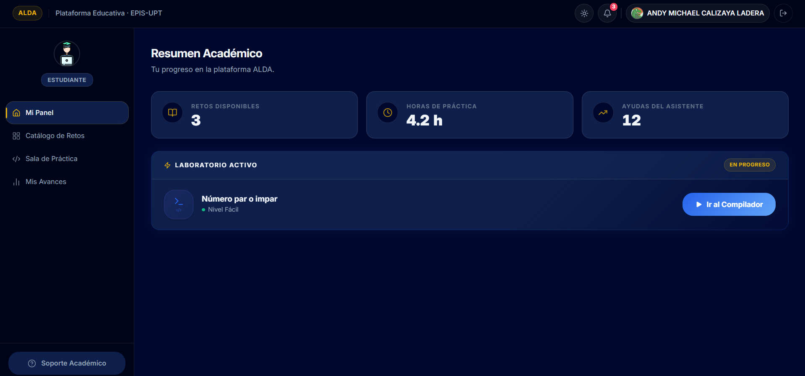

# Pruebas funcionales

> Documento de prueba funcional del caso CP-07. Se conservan los datos, las tablas, los resultados y las capturas de evidencia.

## Caso de prueba CP-07 — Validar acceso por dominio institucional

| Campo | Detalle |
|---|---|
| Caso N° | CP-07 |
| Caso de uso | Validar acceso por dominio institucional |
| Versión de ejecución | v1.0 |
| Fecha de ejecución | 24/11/2026 |
| Hora de ejecución | 3:00 p.m. |
| Módulo del sistema | Seguridad y Autenticación |

### Descripción de caso

Este caso de prueba verifica que un usuario con correo institucional `@virtual.upt.pe` pueda completar el proceso de autenticación OAuth2 con Google y acceder al sistema sin restricciones. El objetivo es comprobar que el flujo de login con cuenta institucional funcione correctamente, que el sistema autentique al usuario vía OAuth2, muestre el mensaje de bienvenida y redirija al dashboard principal con todas las opciones disponibles.

### 1. Caso de Prueba

**Tipo de prueba:** Funcional.

#### a. Precondiciones que deben cumplir para realizar la prueba

1. El sistema (plataforma ALDA) debe estar desplegado y accesible desde un navegador web.
2. Debe existir una cuenta de Google con dominio `@virtual.upt.pe` válida y activa.
3. La conexión a internet debe estar activa.
4. El navegador debe tener JavaScript habilitado.
5. El CP-06 (Validar Lógica de Dominio Institucional) debe haberse ejecutado exitosamente.

#### b. Pasos secuenciales para poder ejecutar

Representa la secuencia de pasos que deberán ser ejecutadas para verificar el caso de Prueba.

##### Flujo Normal: Acceso exitoso con dominio institucional

| N° | Pasos | Resultado Esperado |
|---|---|---|
| 1 | Abrir el navegador e ingresar a la URL de la plataforma ALDA. Se muestra la página de login con el logotipo de ALDA, la descripción del sistema y el botón "Iniciar sesión con Google". | El sistema muestra la página de inicio de sesión correctamente con el botón de autenticación Google OAuth2. |
| 2 | Hacer clic en el botón "Iniciar sesión con Google" y seleccionar una cuenta con dominio `@virtual.upt.pe` (ej. `2021069266@virtual.upt.pe`). | Se abre el popup de Google OAuth2 y el usuario selecciona su cuenta institucional. |
| 3 | Completar la autenticación en la ventana de Google OAuth2 e ingresar las credenciales si se solicitan. | Google autentica al usuario y envía el token al Backend de ALDA. El Backend valida que el dominio sea `@virtual.upt.pe` mediante `validate_email_eligibility`, crea o recupera la sesión del usuario y devuelve los datos del perfil. |
| 4 | Verificar que el sistema muestre el toast de bienvenida "Bienvenido {nombre}" y redirija al dashboard principal del estudiante. | El sistema muestra el toast "Bienvenido ANDY MICHAEL CALIZAYA LADERA" y redirige al dashboard mostrando las opciones del menú lateral: Mi Panel, Catálogo de Retos, Sala de Práctica y Mis Avances. El nombre del usuario aparece en la esquina superior derecha. |

**Evidencia del flujo normal:**

#### c. Post condiciones que deben cumplirse para la realización de la prueba

- El usuario con cuenta `@virtual.upt.pe` ha iniciado sesión exitosamente en la plataforma ALDA.
- El sistema ha redirigido al dashboard principal del estudiante con todas las opciones visibles.
- La sesión del usuario ha quedado registrada en el Backend.
- El nombre del usuario aparece correctamente en la barra superior de la interfaz.

### 2. RESULTADOS DE LA PRUEBA

| Defectos y desviaciones encontradas en las pruebas | Resultado (marcar x) |
|---|---|
| La prueba se realizó exitosamente sin encontrar algún error o bug durante la ejecución. El usuario con correo `@virtual.upt.pe` pudo autenticarse vía OAuth2 y acceder al dashboard principal sin restricciones. | **[x] Con éxito** [ ] Paralizada [ ] Suspendida |

### Observaciones generales

Ninguna.

### Responsable de Prueba

**Primer responsable**

- Nombre: Andy Calizaya
- Fecha: 24/11/2026
- Firma:

**Segundo responsable**

- Nombre: Gregory Huanca Merma
- Fecha: 24/11/2026
- Firma:

---
