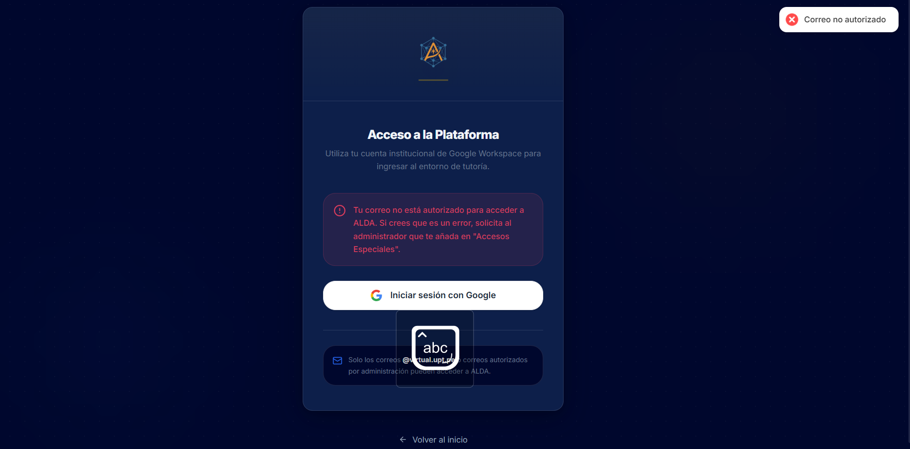

# CASO DE PRUEBA

**Fecha:** 24/11/2026

| Campo | Detalle |
|---|---|
| **Caso de uso** | Validar acceso por dominio institucional |
| **Caso N°** | CP-08 |
| **Versión de ejecución** | v1.0 |
| **Fecha de ejecución** | 24/11/2026 – 3:10 p.m. |
| **Módulo del sistema** | Seguridad y Autenticación |
| **Descripción del caso** | Confirmar que un usuario con dominio no institucional que no esté en lista blanca sea rechazado al momento del login, visualizando un mensaje de error apropiado. |

---

## 7. Caso de Prueba

**Tipo de prueba:** Aceptación

### a. Precondiciones que deben cumplirse para realizar la prueba

- El sistema (plataforma ALDA) debe estar desplegado y accesible desde un navegador web.
- Debe existir una cuenta de Google con dominio externo (ej. `@gmail.com`) que **no** esté en la lista blanca (`AllowedEmail`).
- La conexión a internet debe estar activa.
- El navegador debe tener JavaScript habilitado.

### b. Pasos secuenciales para poder ejecutar

Representa la secuencia de pasos que deberán ser ejecutados para verificar el caso de prueba.

#### Flujo Normal: Rechazo de cuenta no institucional

| N° | Pasos | Resultado esperado |
|---|---|---|
| 1 | El usuario abre el navegador e ingresa a la URL de la plataforma ALDA. Se muestra la página de login con el botón "Iniciar sesión con Google". | La página de login se muestra correctamente con el botón de autenticación OAuth2. |
| 2 | El usuario hace clic en "Iniciar sesión con Google" y selecciona una cuenta con dominio no institucional (ej. `usuario@gmail.com`). | Se abre el popup de Google OAuth2 y el usuario selecciona su cuenta externa. |
| 3 | Google autentica al usuario y envía el token al Backend. El Backend ejecuta `validate_email_eligibility` que verifica que el dominio no es `@virtual.upt.pe` y que el correo no está en la tabla `AllowedEmail`. | El Backend rechaza el acceso con HTTP 403 y el mensaje "Correo no autorizado". |
| 4 | Se verifica que la interfaz muestre un mensaje de error claro indicando que el correo no está autorizado y que el usuario permanezca en la página de login sin acceder al dashboard. | El Frontend muestra un toast "Correo no autorizado" y un recuadro rojo con el mensaje "Tu correo no está autorizado para acceder a ALDA". El usuario permanece en la página de login. |

#### Flujo Alternativo: Cuenta externa en lista blanca

| N° | Pasos | Resultado esperado |
|---|---|---|
| 1 | Si el correo externo ha sido agregado previamente a la lista blanca (`AllowedEmail`) por un administrador, el sistema debe permitir el acceso. | El sistema autentica al usuario y lo redirige al dashboard principal, ya que el correo fue autorizado explícitamente por un administrador. |

### c. Postcondiciones que deben cumplirse para la realización de la prueba

- El usuario con dominio no institucional ha sido rechazado correctamente por el sistema.
- Se muestra un mensaje de error claro e informativo en la interfaz ("Correo no autorizado").
- El usuario permanece en la página de login sin acceder a ningún módulo del sistema.
- No se ha creado ningún registro de sesión ni usuario en la base de datos para el correo rechazado.

---

## 8. RESULTADOS DE LA PRUEBA

**Defectos y desviaciones encontradas en las pruebas:**
La prueba se realizó exitosamente sin encontrar errores o bugs en sus diferentes escenarios. El sistema rechaza correctamente el acceso de cuentas con dominio no institucional y muestra un mensaje de error claro.

**Resultado (marcar x):**

- [x] Con éxito
- [ ] Paralizada
- [ ] Suspendida

| Observaciones generales | Responsable de prueba |
|---|---|
| El Backend rechaza con HTTP 403 y el Frontend muestra el toast "Correo no autorizado" junto con un recuadro rojo informativo. El usuario permanece en la página de login sin acceder al dashboard. La función `validate_email_eligibility` verifica correctamente el dominio y la tabla `AllowedEmail`. | **Firma:** *(firmado)* **Nombre:** Andy Calizaya **Fecha:** 24/11/2026 |
|  | **Firma:** *(firmado)* **Nombre:** Gregory Huanca Merma **Fecha:** 24/11/2026 |

---

**Evidencia:**

---

*Confidential © EPIS-UPT, 2026*
