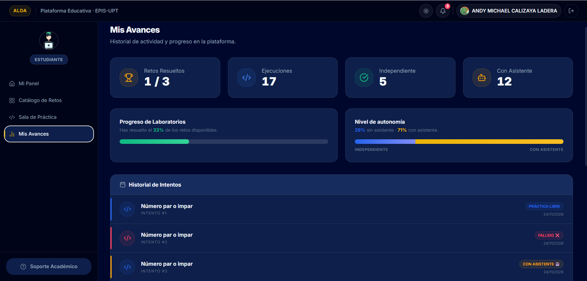

# Pruebas funcionales

> Documento de prueba funcional del caso CP-12. Se conservan los datos, las tablas, los resultados y las capturas de evidencia.

## Caso de prueba CP-12 — Consultar panel de progreso personal

| Campo | Detalle |
|---|---|
| Caso N° | CP-12 |
| Caso de uso | Consultar panel de progreso personal |
| Versión de ejecución | v1.0 |
| Fecha de ejecución | 24/11/2026 |
| Hora de ejecución | 3:20 p.m. |
| Módulo del sistema | Estudiante |

### Descripción de caso

Este caso de prueba verifica que el dashboard del estudiante muestre correctamente su progreso personal: gráficas de avance, número de retos completados e intentos realizados. El objetivo es comprobar que la sección "Mis Avances" presente las métricas de progreso del estudiante autenticado con datos reales provenientes de la base de datos.

### 1. Caso de Prueba

**Tipo de prueba:** Funcional.

#### a. Precondiciones que deben cumplir para realizar la prueba

1. El sistema (plataforma ALDA) debe estar desplegado y accesible desde un navegador web.
2. Debe existir una cuenta de estudiante con correo `@virtual.upt.pe` registrada y activa.
3. El estudiante debe tener al menos algunos intentos realizados en laboratorios para visualizar datos de progreso.
4. La conexión a internet debe estar activa.
5. El CP-11 (Cálculo de Métricas de Progreso) debe haberse ejecutado exitosamente.

#### b. Pasos secuenciales para poder ejecutar

Representa la secuencia de pasos que deberán ser ejecutadas para verificar el caso de Prueba.

##### Flujo Normal: Visualización del panel de progreso personal

| N° | Pasos | Resultado Esperado |
|---|---|---|
| 1 | Abrir el navegador e ingresar a la URL de la plataforma ALDA. Iniciar sesión con una cuenta de estudiante válida (`@virtual.upt.pe`). | El sistema autentica al usuario vía OAuth2 y redirige al dashboard del estudiante. |
| 2 | En el menú lateral izquierdo, hacer clic en "Mis Avances". | El sistema muestra la sección "Mis Avances" con el panel de progreso personal del estudiante. |
| 3 | Verificar que se muestren las tarjetas de métricas principales: "Total Intentos" (número total de intentos realizados), "Labs Completados" (número de laboratorios aprobados), "Tasa de Éxito" (porcentaje de intentos exitosos) y "Racha Actual" (días consecutivos de práctica). | Las tarjetas de métricas se muestran correctamente con los valores numéricos correspondientes a la actividad del estudiante autenticado. |
| 4 | Verificar que se muestren las barras de progreso por laboratorio indicando el porcentaje de avance y el estado (completado/en progreso/no iniciado) de cada reto. | Se muestran las barras de progreso de los laboratorios con su porcentaje de avance, número de intentos y estado visual diferenciado (verde para completado, amarillo para en progreso). |
| 5 | Verificar que se muestre el historial de actividad reciente con los intentos más recientes del estudiante, incluyendo el nombre del laboratorio, la fecha y si fue aprobado o no. | El historial de actividad reciente muestra los intentos más recientes ordenados cronológicamente con el ícono de estado (aprobado/no aprobado), el nombre del laboratorio y la fecha/hora del intento. |

**Evidencia del flujo normal:**

#### c. Post condiciones que deben cumplirse para la realización de la prueba

- La sección "Mis Avances" se ha cargado correctamente con los datos del estudiante autenticado.
- Las métricas de progreso (Total Intentos, Labs Completados, Tasa de Éxito, Racha Actual) se muestran con valores reales.
- Las barras de progreso reflejan el avance real del estudiante en cada laboratorio.
- El historial de actividad reciente muestra los intentos más recientes del estudiante.

### 2. RESULTADOS DE LA PRUEBA

| Defectos y desviaciones encontradas en las pruebas | Resultado (marcar x) |
|---|---|
| La prueba se realizó exitosamente sin encontrar algún error o bug durante la ejecución. El panel de progreso "Mis Avances" muestra correctamente todas las métricas, barras de progreso e historial del estudiante autenticado. | **[x] Con éxito** [ ] Paralizada [ ] Suspendida |

### Observaciones generales

Ninguna.

### Responsable de Prueba

**Primer responsable**

- Nombre: Andy Calizaya
- Fecha: 24/11/2026
- Firma:

**Segundo responsable**

- Nombre: Gregory Huanca Merma
- Fecha: 24/11/2026
- Firma:

---
