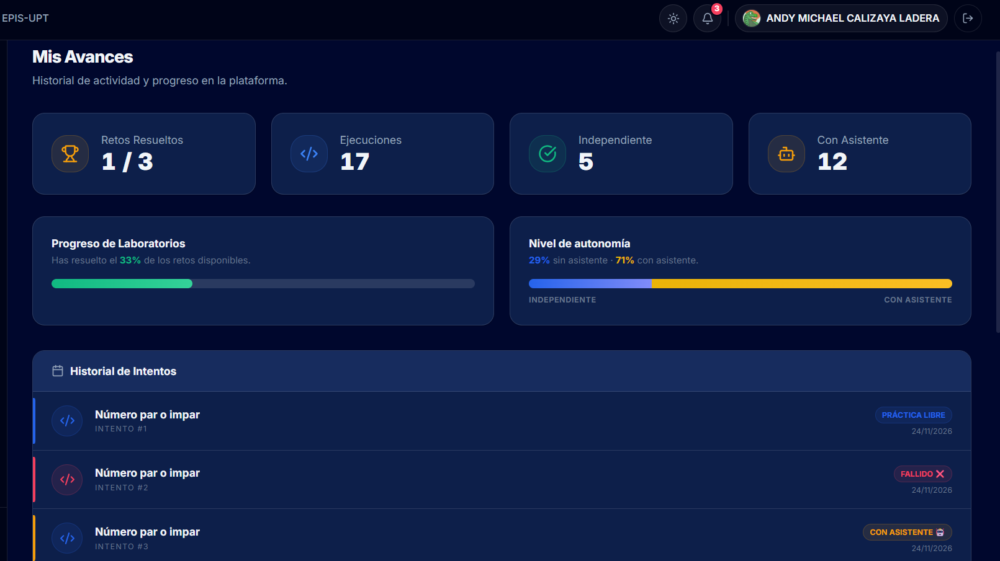
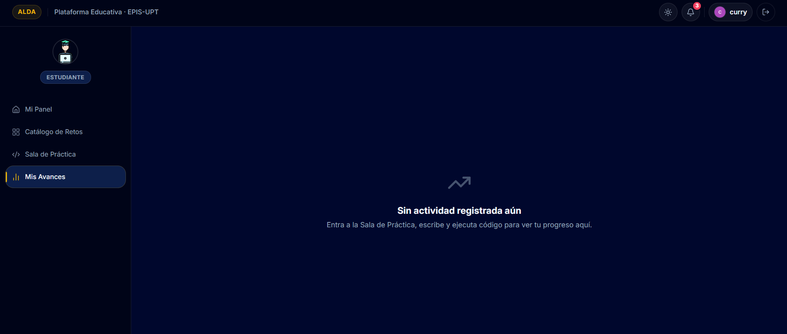

# CASO DE PRUEBA

**Fecha:** 24/11/2026

| Campo | Detalle |
|---|---|
| **Caso de uso** | Consultar panel de progreso personal |
| **Caso N°** | CP-13 |
| **Versión de ejecución** | v1.0 |
| **Fecha de ejecución** | 24/11/2026 – 3:30 p.m. |
| **Módulo del sistema** | Seguridad |
| **Descripción del caso** | Verificar que el estudiante autenticado solo pueda visualizar su propio panel de progreso y no el de otros compañeros, garantizando el aislamiento de datos personales. |

---

## 7. Caso de Prueba

**Tipo de prueba:** Aceptación

### a. Precondiciones que deben cumplirse para realizar la prueba

- El sistema (plataforma ALDA) debe estar desplegado y accesible desde un navegador web.
- Deben existir al menos dos cuentas de estudiante con correo `@virtual.upt.pe` registradas y activas.
- Ambos estudiantes deben tener intentos realizados en laboratorios para que sus paneles de progreso muestren datos distintos.
- El CP-12 (Visualización Panel de Progreso) debe haberse ejecutado exitosamente.

### b. Pasos secuenciales para poder ejecutar

Representa la secuencia de pasos que deberán ser ejecutados para verificar el caso de prueba.

#### Flujo Normal: Verificar aislamiento de progreso entre estudiantes

| N° | Pasos | Resultado esperado |
|---|---|---|
| 1 | El estudiante A inicia sesión en la plataforma ALDA con su cuenta institucional y accede a "Mis Avances" desde el menú lateral. | El panel de progreso muestra las métricas, barras de avance e historial correspondientes exclusivamente al estudiante A. |
| 2 | Se registran los valores de las métricas del estudiante A: Total Intentos, Labs Completados, Tasa de Éxito y el historial de actividad reciente. | Los valores de métricas e historial del estudiante A quedan documentados para comparación. |
| 3 | Se cierra la sesión del estudiante A y se inicia sesión con la cuenta del estudiante B. Se accede a "Mis Avances" desde el menú lateral. | El panel de progreso muestra las métricas, barras de avance e historial correspondientes exclusivamente al estudiante B. |
| 4 | Se comparan los valores de métricas e historial del estudiante B con los del estudiante A. Se verifica que los datos sean diferentes y correspondan a la actividad de cada estudiante respectivamente. | Los datos de progreso son distintos entre ambos estudiantes. El estudiante B no puede ver las métricas, barras de avance ni historial del estudiante A. Cada panel muestra únicamente los datos del usuario autenticado. |
| 5 | Se verifica que no exista ninguna opción en la interfaz para buscar o consultar el progreso de otros estudiantes (no hay campo de búsqueda de usuarios ni selector de estudiante en "Mis Avances"). | La interfaz de "Mis Avances" no ofrece ninguna forma de consultar datos de otros estudiantes. Los datos se filtran automáticamente por el usuario autenticado a nivel del Backend (endpoint `/api/student/progress`). |

### c. Postcondiciones que deben cumplirse para la realización de la prueba

- El estudiante A solo visualiza sus propios datos de progreso.
- El estudiante B solo visualiza sus propios datos de progreso.
- No existe ningún mecanismo en la interfaz para consultar el progreso de otro estudiante.
- El Backend filtra automáticamente los datos por el usuario autenticado.

---

## 8. RESULTADOS DE LA PRUEBA

**Defectos y desviaciones encontradas en las pruebas:**
La prueba se realizó exitosamente sin encontrar errores o bugs en sus diferentes escenarios. Cada estudiante visualiza únicamente su propio progreso y no existe forma de acceder a los datos de otros estudiantes.

**Resultado (marcar x):**

- [x] Con éxito
- [ ] Paralizada
- [ ] Suspendida

| Observaciones generales | Responsable de prueba |
|---|---|
| El aislamiento de datos funciona correctamente. Cada estudiante ve exclusivamente sus métricas (Total Intentos, Labs Completados, Tasa de Éxito), barras de progreso e historial de actividad. El Backend filtra por el usuario autenticado en el endpoint `/api/student/progress`, impidiendo el acceso a datos ajenos. No existe ningún selector ni campo de búsqueda que permita consultar el progreso de otros compañeros. | **Firma:** *(firmado)* **Nombre:** Andy Calizaya **Fecha:** 24/11/2026 |
|  | **Firma:** *(firmado)* **Nombre:** Gregory Huanca Merma **Fecha:** 24/11/2026 |

---

**Evidencias:**

---

*Confidential © EPIS-UPT, 2026*
