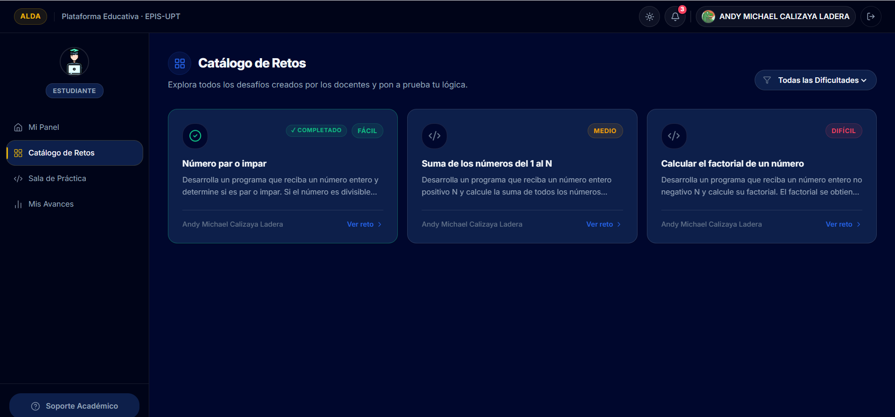

# Pruebas funcionales

> Documento de prueba funcional del caso CP-17. Se conservan los datos, las tablas, los resultados y las capturas de evidencia.

## Caso de prueba CP-17 — Explorar catálogo de retos disponibles

| Campo | Detalle |
|---|---|
| Caso N° | CP-17 |
| Caso de uso | Explorar catálogo de retos disponibles |
| Versión de ejecución | v1.0 |
| Fecha de ejecución | 24/11/2026 |
| Hora de ejecución | 6:00 p.m. |
| Módulo del sistema | Estudiante |

### Descripción de caso

Este caso de prueba verifica que el estudiante autenticado pueda ver el listado completo de retos disponibles, con su título, nivel de dificultad y estado (completado/pendiente). El objetivo es comprobar que la sección "Catálogo de Retos" presente correctamente las tarjetas de cada laboratorio publicado con toda la información relevante para el estudiante.

### 1. Caso de Prueba

**Tipo de prueba:** Funcional.

#### a. Precondiciones que deben cumplir para realizar la prueba

1. El sistema (plataforma ALDA) debe estar desplegado y accesible desde un navegador web.
2. Debe existir una cuenta de estudiante con correo `@virtual.upt.pe` registrada y activa.
3. Deben existir al menos 5 retos publicados por docentes en la base de datos.
4. El estudiante debe tener al menos un reto completado para verificar el estado visual.
5. La conexión a internet debe estar activa.
6. El CP-16 (Filtrado de Retos por Dificultad) debe haberse ejecutado exitosamente.

#### b. Pasos secuenciales para poder ejecutar

Representa la secuencia de pasos que deberán ser ejecutadas para verificar el caso de Prueba.

##### Flujo Normal: Visualización del catálogo de retos

| N° | Pasos | Resultado Esperado |
|---|---|---|
| 1 | Abrir el navegador e ingresar a la URL de la plataforma ALDA. Iniciar sesión con una cuenta de estudiante válida (`@virtual.upt.pe`). | El sistema autentica al usuario vía OAuth2 y redirige al dashboard del estudiante. |
| 2 | En el menú lateral izquierdo, hacer clic en "Catálogo de Retos". | El sistema muestra la sección "Catálogo de Retos" con el encabezado, la descripción "Explora todos los desafíos creados por los docentes y pon a prueba tu lógica." y el filtro de dificultad en la esquina superior derecha. |
| 3 | Verificar que se muestren las tarjetas de retos en un grid responsivo. Cada tarjeta debe contener: el **título** del reto, una **descripción** breve, un badge de **dificultad** con color diferenciado (verde "Fácil", amarillo "Medio", rojo "Difícil"), el **nombre del docente** que lo creó, y el estado **"✓ Completado"** si el estudiante ya aprobó ese reto. | Las tarjetas se muestran correctamente con toda la información. Los retos completados tienen un borde verde y el badge "✓ Completado". Los retos pendientes muestran el ícono de código genérico. |
| 4 | Utilizar el filtro desplegable "Todas las Dificultades" y seleccionar "Fáciles". Verificar que solo se muestren retos con dificultad "Fácil". Repetir con "Medios" y "Difíciles". | El filtro funciona correctamente, mostrando solo los retos de la dificultad seleccionada. Al volver a "Todas las Dificultades" se muestran todos los retos disponibles. |
| 5 | Hacer clic en una tarjeta de reto para abrir el modal de detalle. Verificar que muestre el título, la dificultad, el nombre del docente, la descripción completa, un aviso sobre los casos de prueba y el botón "Ir a la Sala de Práctica". | El modal se abre correctamente mostrando toda la información del reto y el botón para navegar a la Sala de Práctica. |

**Evidencia del flujo normal:**

#### c. Post condiciones que deben cumplirse para la realización de la prueba

- El catálogo de retos se ha cargado correctamente con todas las tarjetas de laboratorios publicados.
- Cada tarjeta muestra el título, la descripción, el badge de dificultad y el nombre del docente.
- Los retos completados se distinguen visualmente con el badge "✓ Completado" y borde verde.
- El filtro de dificultad funciona correctamente filtrando las tarjetas según la selección.

### 2. RESULTADOS DE LA PRUEBA

| Defectos y desviaciones encontradas en las pruebas | Resultado (marcar x) |
|---|---|
| La prueba se realizó exitosamente sin encontrar algún error o bug durante la ejecución. El catálogo de retos muestra correctamente todas las tarjetas con título, dificultad, estado y nombre del docente. El filtro por dificultad funciona correctamente. | **[x] Con éxito** [ ] Paralizada [ ] Suspendida |

### Observaciones generales

Ninguna.

### Responsable de Prueba

**Primer responsable**

- Nombre: Andy Calizaya
- Fecha: 24/11/2026
- Firma:

**Segundo responsable**

- Nombre: Gregory Huanca Merma
- Fecha: 24/11/2026
- Firma:

---
