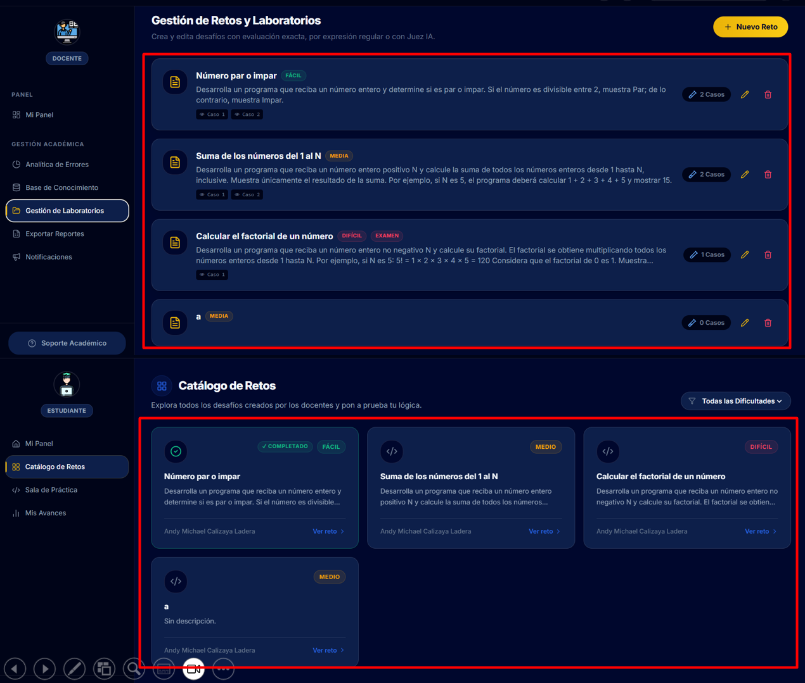

# CASO DE PRUEBA

**Fecha:** 24/11/2026

| Campo | Detalle |
|---|---|
| **Caso de uso** | Explorar catálogo de retos disponibles |
| **Caso N°** | CP-18 |
| **Versión de ejecución** | v1.0 |
| **Fecha de ejecución** | 24/11/2026 – 6:10 p.m. |
| **Módulo del sistema** | Estudiante |
| **Descripción del caso** | Confirmar que el catálogo visible para el estudiante solo incluya retos activos y publicados, ocultando los retos en estado borrador o archivados por el docente. |

---

## 7. Caso de Prueba

**Tipo de prueba:** Aceptación

### a. Precondiciones que deben cumplirse para realizar la prueba

- El sistema (plataforma ALDA) debe estar desplegado y accesible desde un navegador web.
- Debe existir una cuenta de estudiante con correo `@virtual.upt.pe` registrada y activa.
- Deben existir laboratorios publicados (activos) visibles en el catálogo.
- El endpoint `GET /api/student/labs` debe retornar únicamente laboratorios en estado activo/publicado.
- El CP-17 (Visualización Catálogo de Retos) debe haberse ejecutado exitosamente.

### b. Pasos secuenciales para poder ejecutar

Representa la secuencia de pasos que deberán ser ejecutados para verificar el caso de prueba.

#### Flujo Normal: Verificar que solo se muestran retos activos

| N° | Pasos | Resultado esperado |
|---|---|---|
| 1 | El estudiante inicia sesión en la plataforma ALDA con su cuenta institucional (`@virtual.upt.pe`) y accede al "Catálogo de Retos" desde el menú lateral. | El catálogo se carga mostrando las tarjetas de retos disponibles. |
| 2 | Se verifica que todos los retos visibles en el catálogo son laboratorios activos y publicados por docentes, con título, descripción, dificultad y nombre del docente correctamente mostrados. | Todas las tarjetas visibles corresponden a laboratorios publicados. No aparecen retos vacíos, sin título o con datos incompletos que indicarían un borrador. |
| 3 | Se verifica que el endpoint `GET /api/student/labs` filtra internamente los laboratorios, retornando solo aquellos en estado activo. Los retos en estado borrador o archivados por el docente no aparecen en la respuesta del API. | El catálogo del estudiante no incluye retos en borrador ni archivados. Solo se muestran los laboratorios que el docente ha publicado explícitamente. |
| 4 | Se verifica que si no hay retos publicados, el catálogo muestra el estado vacío con el mensaje "Sin retos disponibles" y la sugerencia "Intenta con otro filtro de dificultad." | El estado vacío se muestra correctamente cuando no hay retos que coincidan con el filtro aplicado. |

#### Flujo Alternativo: Reto eliminado por docente

| N° | Pasos | Resultado esperado |
|---|---|---|
| 1 | Si un docente elimina un laboratorio que el estudiante había visto previamente en el catálogo, al recargar la página el reto eliminado ya no debe aparecer. | El catálogo se actualiza correctamente y no muestra laboratorios eliminados. |

### c. Postcondiciones que deben cumplirse para la realización de la prueba

- El catálogo del estudiante muestra exclusivamente retos activos y publicados.
- Los retos en estado borrador o archivados no son visibles para el estudiante.
- El filtrado se realiza a nivel del Backend (endpoint `/api/student/labs`), no solo en el Frontend.

---

## 8. RESULTADOS DE LA PRUEBA

**Defectos y desviaciones encontradas en las pruebas:**
La prueba se realizó exitosamente sin encontrar errores o bugs en sus diferentes escenarios. El catálogo del estudiante muestra únicamente retos activos y publicados.

**Resultado (marcar x):**

- [x] Con éxito
- [ ] Paralizada
- [ ] Suspendida

| Observaciones generales | Responsable de prueba |
|---|---|
| El endpoint `GET /api/student/labs` retorna únicamente laboratorios publicados por docentes. El catálogo no incluye retos en borrador ni archivados. Todas las tarjetas visibles muestran título, descripción, dificultad y nombre del docente correctamente, confirmando que son retos activos. | **Firma:** *(firmado)* **Nombre:** Andy Calizaya **Fecha:** 24/11/2026 |
|  | **Firma:** *(firmado)* **Nombre:** Gregory Huanca Merma **Fecha:** 24/11/2026 |

---

**Evidencia:**

---

*Confidential © EPIS-UPT, 2026*
