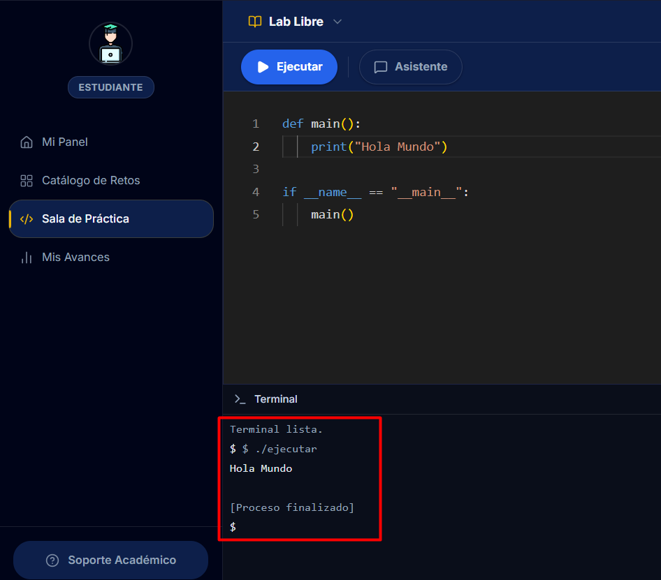
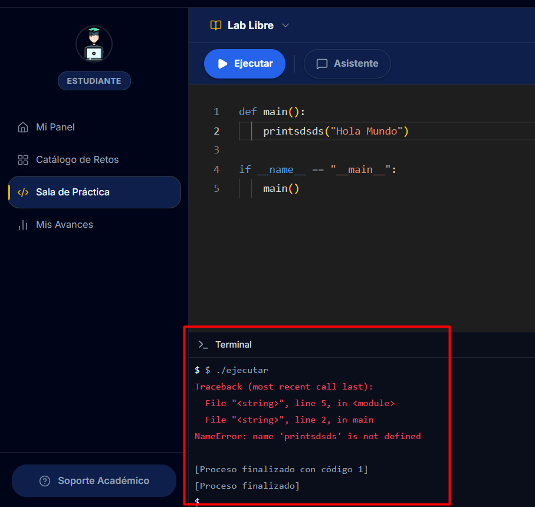

# Pruebas funcionales

> Documento de prueba funcional del caso CP-22. Se conservan los datos, las tablas, los resultados y las capturas de evidencia.

## Caso de prueba CP-22 — Escribir y ejecutar código en el editor

| Campo | Detalle |
|---|---|
| Caso N° | CP-22 |
| Caso de uso | Escribir y ejecutar código en el editor |
| Versión de ejecución | v1.0 |
| Fecha de ejecución | 24/11/2026 |
| Hora de ejecución | 6:20 p.m. |
| Módulo del sistema | Estudiante |

### Descripción de caso

Este caso de prueba verifica que el estudiante pueda escribir código Python en el editor web, ejecutarlo y recibir la salida (stdout/stderr) correctamente en la interfaz. El objetivo es comprobar que el editor Monaco funcione correctamente, que el botón "Ejecutar" envíe el código al Backend vía WebSocket, y que la Terminal inferior muestre la salida estándar o los errores de ejecución.

### 1. Caso de Prueba

**Tipo de prueba:** Funcional.

#### a. Precondiciones que deben cumplir para realizar la prueba

1. El sistema (plataforma ALDA) debe estar desplegado y accesible desde un navegador web.
2. Debe existir una cuenta de estudiante con correo `@virtual.upt.pe` registrada y activa.
3. Debe existir al menos un laboratorio publicado por un docente.
4. El Backend debe tener Docker configurado para ejecutar código en contenedores aislados.
5. La conexión a internet debe estar activa.
6. El CP-21 (Validación Sintáctica del Código) debe haberse ejecutado exitosamente.

#### b. Pasos secuenciales para poder ejecutar

Representa la secuencia de pasos que deberán ser ejecutadas para verificar el caso de Prueba.

##### Flujo Normal: Ejecución exitosa de código Python

| N° | Pasos | Resultado Esperado |
|---|---|---|
| 1 | Abrir el navegador e ingresar a la URL de la plataforma ALDA. Iniciar sesión con una cuenta de estudiante válida (`@virtual.upt.pe`). | El sistema autentica al usuario vía OAuth2 y redirige al dashboard del estudiante. |
| 2 | En el menú lateral izquierdo, hacer clic en "Sala de Práctica". | El sistema muestra la Sala de Práctica con el editor de código Monaco, la barra superior con el selector de laboratorio, los botones "Ejecutar" y "Asistente", el selector de lenguaje y la Terminal inferior. |
| 3 | Seleccionar un laboratorio activo desde el selector desplegable (ej. "Suma de los números del 1 al N"). Verificar que el selector de lenguaje muestre "Python" como opción. | El laboratorio queda seleccionado y su título se muestra en la barra superior. El selector de lenguaje muestra "Python" como opción disponible. |
| 4 | Escribir el siguiente código correcto en el editor Monaco: `def main():` / `    print("Hola Mundo")` / `if __name__ == "__main__":` / `    main()`. | El editor acepta el código con resaltado de sintaxis Python y numeración de líneas. |
| 5 | Hacer clic en el botón "Ejecutar" (ícono ▶ verde). | El botón cambia a "Procesando..." con un spinner. La Terminal inferior muestra la conexión WebSocket (`$ ./ejecutar`), la salida `Hola Mundo` y el mensaje `[Proceso finalizado]`. |

**Evidencia del flujo normal:**

##### Flujo Alternativo: Ejecución con error en el código

| N° | Pasos | Resultado Esperado |
|---|---|---|
| 1 | Modificar el código en el editor introduciendo un error intencional: cambiar `print("Hola Mundo")` por `printsdsds("Hola Mundoa")`. | El editor acepta el texto modificado. |
| 2 | Hacer clic en el botón "Ejecutar". | La Terminal inferior muestra el error de ejecución: `NameError: name 'printsdsds' is not defined` junto con el traceback de Python indicando el archivo y la línea del error. Se muestra `[Proceso finalizado con código 1]`. |

**Evidencia del flujo alternativo:**

#### c. Post condiciones que deben cumplirse para la realización de la prueba

- El estudiante ha ejecutado código Python exitosamente desde el editor web.
- La Terminal muestra correctamente la salida estándar (stdout) del programa.
- En caso de error, la Terminal muestra el mensaje de error (stderr) con el traceback completo.
- El intento de ejecución ha quedado registrado en la base de datos (tabla `attempts`).

### 2. RESULTADOS DE LA PRUEBA

| Defectos y desviaciones encontradas en las pruebas | Resultado (marcar x) |
|---|---|
| La prueba se realizó exitosamente sin encontrar algún error o bug durante la ejecución. El editor Monaco permite escribir código Python, el botón "Ejecutar" envía el código al Backend vía WebSocket, y la Terminal muestra correctamente tanto la salida exitosa como los errores de ejecución. | **[x] Con éxito** [ ] Paralizada [ ] Suspendida |

### Observaciones generales

Ninguna.

### Responsable de Prueba

**Primer responsable**

- Nombre: Andy Calizaya
- Fecha: 24/11/2026
- Firma:

**Segundo responsable**

- Nombre: Gregory Huanca Merma
- Fecha: 24/11/2026
- Firma:

---
