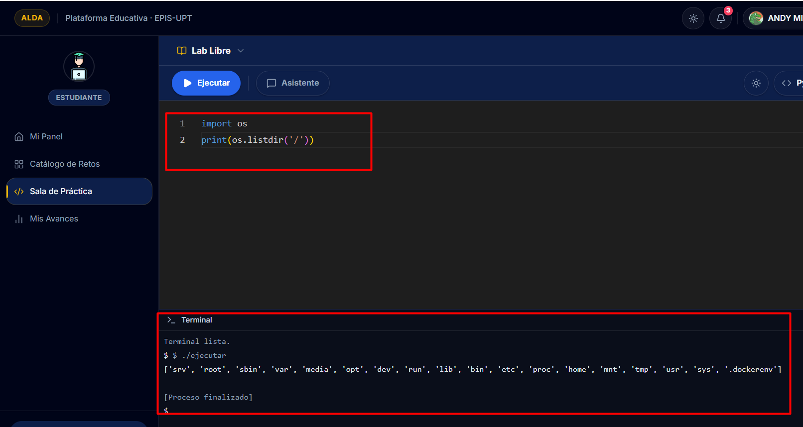

# CASO DE PRUEBA

**Fecha:** 24/11/2026

| Campo | Detalle |
|---|---|
| **Caso de uso** | Escribir y ejecutar código en el editor |
| **Caso N°** | CP-23 |
| **Versión de ejecución** | v1.0 |
| **Fecha de ejecución** | 24/11/2026 – 6:30 p.m. |
| **Módulo del sistema** | Seguridad |
| **Descripción del caso** | Confirmar que el entorno de ejecución de código esté aislado (sandbox), impidiendo que el código del estudiante acceda al sistema de archivos del servidor o ejecute comandos peligrosos. |

---

## 7. Caso de Prueba

**Tipo de prueba:** Aceptación

### a. Precondiciones que deben cumplirse para realizar la prueba

- El sistema (plataforma ALDA) debe estar desplegado y accesible desde un navegador web.
- Debe existir una cuenta de estudiante con correo `@virtual.upt.pe` registrada y activa.
- El Backend debe tener Docker configurado con las restricciones de seguridad: `--network=none`, `--read-only`, `--cap-drop=ALL`, `--memory=512m`, `--pids-limit=100`.
- El CP-22 (Ejecución de Código en Editor) debe haberse ejecutado exitosamente.

### b. Pasos secuenciales para poder ejecutar

Representa la secuencia de pasos que deberán ser ejecutados para verificar el caso de prueba.

#### Flujo Normal: Verificar aislamiento del sandbox

| N° | Pasos | Resultado esperado |
|---|---|---|
| 1 | El estudiante inicia sesión en la plataforma ALDA y accede a la "Sala de Práctica" desde el menú lateral. Selecciona un laboratorio activo y el lenguaje Python. | La Sala de Práctica se muestra con el editor Monaco, la Terminal y el selector de lenguaje en "Python". |
| 2 | El estudiante escribe código que intenta acceder al sistema de archivos: `import os` / `print(os.listdir('/'))` y hace clic en "Ejecutar". | La Terminal muestra el contenido del directorio raíz del **contenedor Docker aislado** (ej. `['bin', 'dev', 'etc', 'home', 'lib', ...]`), no del servidor host. El sistema de archivos visible es el del contenedor con `--read-only`, no el del servidor real. |
| 3 | Se verifica que el contenedor ejecuta sin acceso a red escribiendo código que intente conexión: `import urllib.request` / `urllib.request.urlopen('http://google.com')` y haciendo clic en "Ejecutar". | La Terminal muestra un error de conexión (ej. `URLError` o timeout) ya que el contenedor corre con `--network=none`, confirmando que no tiene acceso a internet. |
| 4 | Se verifica que el contenedor tiene recursos limitados: el proceso corre con `--memory=512m`, `--cpus=2.0` y `--pids-limit=100`, impidiendo que el código del estudiante consuma recursos excesivos del servidor. | El código se ejecuta dentro de los límites establecidos. Un programa que intente consumir memoria excesiva será terminado automáticamente por Docker. |

#### Flujo Alternativo: Intento de escritura en filesystem

| N° | Pasos | Resultado esperado |
|---|---|---|
| 1 | El estudiante escribe código que intenta crear un archivo: `with open('/test.txt', 'w') as f: f.write('hack')` y hace clic en "Ejecutar". | La Terminal muestra un error de permisos (`OSError: Read-only file system`) ya que el contenedor corre con `--read-only`, confirmando que no se puede escribir en el filesystem. |

### c. Postcondiciones que deben cumplirse para la realización de la prueba

- El código del estudiante se ejecuta en un contenedor Docker aislado, no directamente en el servidor.
- El contenedor no tiene acceso a red (`--network=none`).
- El filesystem del contenedor es de solo lectura (`--read-only`).
- Los recursos están limitados (`--memory=512m`, `--cpus=2.0`, `--pids-limit=100`).
- Las capacidades del sistema están eliminadas (`--cap-drop=ALL`, `--security-opt=no-new-privileges`).

---

## 8. RESULTADOS DE LA PRUEBA

**Defectos y desviaciones encontradas en las pruebas:**
La prueba se realizó exitosamente sin encontrar errores o bugs en sus diferentes escenarios. El sandbox Docker aísla correctamente la ejecución del código del estudiante.

**Resultado (marcar x):**

- [x] Con éxito
- [ ] Paralizada
- [ ] Suspendida

| Observaciones generales | Responsable de prueba |
|---|---|
| El entorno de ejecución está correctamente aislado mediante contenedores Docker con las restricciones de seguridad: `--network=none` (sin red), `--read-only` (filesystem de solo lectura), `--cap-drop=ALL` (sin capacidades del sistema), `--memory=512m` (memoria limitada), `--pids-limit=100` (límite de procesos) y `--security-opt=no-new-privileges`. El código del estudiante no puede acceder al servidor host ni a recursos externos. | **Firma:** *(firmado)* **Nombre:** Andy Calizaya **Fecha:** 24/11/2026 |
|  | **Firma:** *(firmado)* **Nombre:** Gregory Huanca Merma **Fecha:** 24/11/2026 |

---

**Evidencia:**

---

*Confidential © EPIS-UPT, 2026*
