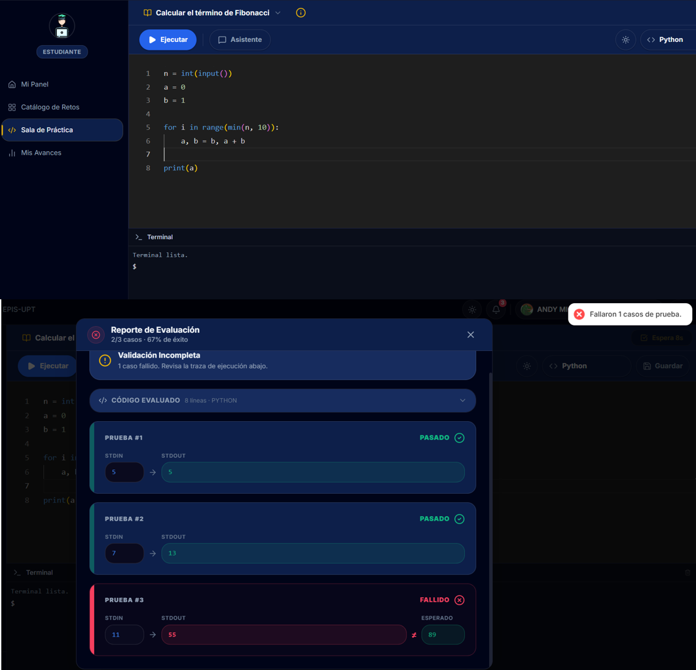

# Pruebas funcionales

> Documento de prueba funcional del caso CP-27. Se conservan los datos, las tablas, los resultados y las capturas de evidencia.

## Caso de prueba CP-27 — Evaluar código con casos de prueba

| Campo | Detalle |
|---|---|
| Caso N° | CP-27 |
| Caso de uso | Evaluar código con casos de prueba |
| Versión de ejecución | v1.0 |
| Fecha de ejecución | 24/11/2026 |
| Hora de ejecución | 6:40 p.m. |
| Módulo del sistema | Estudiante |

### Descripción de caso

Este caso de prueba verifica que el estudiante pueda ver de forma clara cuántos casos de prueba pasó, cuántos falló y la retroalimentación detallada para cada caso fallido. El objetivo es comprobar que el modal "Reporte de Evaluación" presente correctamente los resultados de la evaluación del código contra los casos de prueba definidos por el docente.

### 1. Caso de Prueba

**Tipo de prueba:** Funcional.

#### a. Precondiciones que deben cumplir para realizar la prueba

1. El sistema (plataforma ALDA) debe estar desplegado y accesible desde un navegador web.
2. Debe existir una cuenta de estudiante con correo `@virtual.upt.pe` registrada y activa.
3. Debe existir al menos un laboratorio publicado con casos de prueba definidos por el docente.
4. El estudiante debe haber escrito código en el editor para ser evaluado.
5. El CP-26 (Evaluación Correcta de Casos de Prueba) debe haberse ejecutado exitosamente.

#### b. Pasos secuenciales para poder ejecutar

Representa la secuencia de pasos que deberán ser ejecutadas para verificar el caso de Prueba.

##### Flujo Normal: Visualización de resultados de evaluación

| N° | Pasos | Resultado Esperado |
|---|---|---|
| 1 | Abrir el navegador e ingresar a la URL de la plataforma ALDA. Iniciar sesión con una cuenta de estudiante válida (`@virtual.upt.pe`). | El sistema autentica al usuario vía OAuth2 y redirige al dashboard del estudiante. |
| 2 | En el menú lateral, hacer clic en "Sala de Práctica". Seleccionar un laboratorio que tenga casos de prueba definidos. | La Sala de Práctica se muestra con el editor Monaco, la Terminal y el botón "Evaluar Reto" en la esquina superior derecha. |
| 3 | Escribir una solución en el editor (correcta o parcialmente correcta) y hacer clic en el botón "Evaluar Reto". | El sistema muestra una animación de progreso con las etapas: "Preparando entorno seguro...", "Compilando código fuente...", "Ejecutando casos de prueba..." y "Análisis de IA Semántica en proceso...". Luego se abre el modal "Reporte de Evaluación". |
| 4 | Verificar que el encabezado del modal muestre el conteo de casos: **"X/Y casos · Z% de éxito"** donde X son los casos pasados, Y el total y Z el porcentaje de éxito. | El encabezado muestra correctamente el resumen numérico de la evaluación. |
| 5 | Verificar que cada caso de prueba individual muestre: el número de prueba (**"Prueba #N"**), el estado (**"PASADO"** en verde o **"FALLIDO"** en rojo), y para los casos visibles: los valores de **stdin** (entrada), **stdout** (salida obtenida) y **esperado** (salida esperada). Para los casos fallidos, se muestra la comparación con el ícono **≠** entre la salida obtenida y la esperada. | Los resultados se muestran correctamente con la retroalimentación detallada para cada caso. Los casos pasados tienen una barra lateral verde, los fallidos una barra lateral roja. |
| 6 | Si todos los casos pasan, verificar que se muestre el banner verde **"Todos los casos superados"** con el mensaje "Tu solución ha sido registrada como completada." Si hay fallos, verificar el banner amarillo **"Validación Incompleta"** con el conteo de casos fallidos. | El banner de resultado global se muestra correctamente según el resultado de la evaluación. |

**Evidencia del flujo normal:**

#### c. Post condiciones que deben cumplirse para la realización de la prueba

- El modal "Reporte de Evaluación" se ha abierto correctamente con los resultados de la evaluación.
- El conteo de casos pasados/fallidos y el porcentaje de éxito se muestran en el encabezado.
- Cada caso de prueba muestra su estado (PASADO/FALLIDO) y la retroalimentación detallada.
- El intento de evaluación ha quedado registrado en la base de datos (tabla `attempts`).

### 2. RESULTADOS DE LA PRUEBA

| Defectos y desviaciones encontradas en las pruebas | Resultado (marcar x) |
|---|---|
| La prueba se realizó exitosamente sin encontrar algún error o bug durante la ejecución. El modal "Reporte de Evaluación" muestra correctamente el conteo de casos, el porcentaje de éxito, y la retroalimentación detallada para cada caso de prueba incluyendo stdin, stdout y esperado. | **[x] Con éxito** [ ] Paralizada [ ] Suspendida |

### Observaciones generales

Ninguna.

### Responsable de Prueba

**Primer responsable**

- Nombre: Andy Calizaya
- Fecha: 24/11/2026
- Firma:

**Segundo responsable**

- Nombre: Gregory Huanca Merma
- Fecha: 24/11/2026
- Firma:

---
