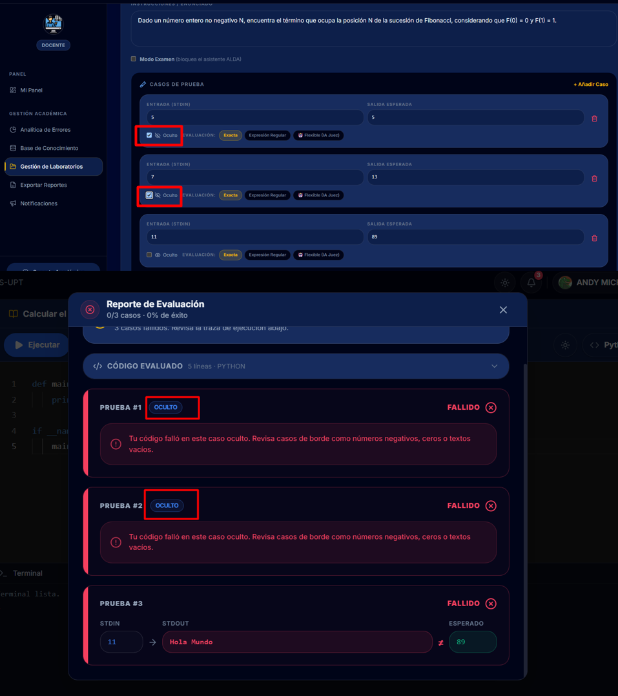

# CASO DE PRUEBA

**Fecha:** 24/11/2026

| Campo | Detalle |
|---|---|
| **Caso de uso** | Evaluar código con casos de prueba |
| **Caso N°** | CP-28 |
| **Versión de ejecución** | v1.0 |
| **Fecha de ejecución** | 24/11/2026 – 6:50 p.m. |
| **Módulo del sistema** | Seguridad |
| **Descripción del caso** | Confirmar que los casos de prueba marcados como "ocultos" por el docente no sean visibles para el estudiante, aunque el resultado (aprobado/fallido) sí se muestre. |

---

## 7. Caso de Prueba

**Tipo de prueba:** Aceptación

### a. Precondiciones que deben cumplirse para realizar la prueba

- El sistema (plataforma ALDA) debe estar desplegado y accesible desde un navegador web.
- Debe existir una cuenta de estudiante con correo `@virtual.upt.pe` registrada y activa.
- Debe existir al menos un laboratorio con casos de prueba marcados como "ocultos" (`is_hidden = true`) por el docente.
- El CP-27 (Visualización Resultados de Evaluación) debe haberse ejecutado exitosamente.

### b. Pasos secuenciales para poder ejecutar

Representa la secuencia de pasos que deberán ser ejecutados para verificar el caso de prueba.

#### Flujo Normal: Verificar ocultamiento de casos de prueba privados

| N° | Pasos | Resultado esperado |
|---|---|---|
| 1 | El estudiante inicia sesión en la plataforma ALDA y accede a la "Sala de Práctica". Selecciona un laboratorio que tenga tanto casos de prueba visibles como ocultos definidos por el docente. | La Sala de Práctica se muestra con el editor y el botón "Evaluar Reto". |
| 2 | El estudiante escribe una solución y hace clic en "Evaluar Reto". Se abre el modal "Reporte de Evaluación" con los resultados. | El modal muestra el conteo total de casos (incluyendo ocultos) y el porcentaje de éxito. |
| 3 | Se verifica que los casos de prueba **visibles** muestren toda la información: número de prueba, estado (PASADO/FALLIDO), valores de **stdin**, **stdout** y **esperado**. | Los casos visibles muestran la retroalimentación completa con entrada, salida obtenida y salida esperada. |
| 4 | Se verifica que los casos de prueba **ocultos** muestren: el badge azul **"Oculto"** junto al número de prueba, el estado (PASADO/FALLIDO), pero **NO** muestren los valores de stdin, stdout ni esperado. En su lugar muestran un mensaje genérico. | Para casos ocultos aprobados: *"La lógica interna es correcta para este caso de prueba privado."* Para casos ocultos fallidos: *"Tu código falló en este caso oculto. Revisa casos de borde como números negativos, ceros o textos vacíos."* |
| 5 | Se verifica a nivel del Backend que el endpoint `POST /api/student/run-tests` retorna `input: null`, `expected: null` y `actual: null` para los casos con `is_hidden = true`, impidiendo que el Frontend acceda a esa información incluso inspeccionando la respuesta del API. | Los campos de entrada y salida son `null` en la respuesta del Backend para casos ocultos, garantizando que la protección es server-side. |

### c. Postcondiciones que deben cumplirse para la realización de la prueba

- Los casos de prueba ocultos muestran el badge "Oculto" y un mensaje genérico sin revelar entrada ni salida.
- Los casos de prueba visibles muestran toda la retroalimentación detallada.
- El Backend retorna `null` para los campos de entrada/salida de casos ocultos (protección server-side).
- El estado (PASADO/FALLIDO) sí se muestra para todos los casos, incluyendo los ocultos.

---

## 8. RESULTADOS DE LA PRUEBA

**Defectos y desviaciones encontradas en las pruebas:**
La prueba se realizó exitosamente sin encontrar errores o bugs en sus diferentes escenarios. Los casos de prueba ocultos no revelan sus valores de entrada/salida al estudiante.

**Resultado (marcar x):**

- [x] Con éxito
- [ ] Paralizada
- [ ] Suspendida

| Observaciones generales | Responsable de prueba |
|---|---|
| Los casos ocultos muestran correctamente el badge "Oculto" y mensajes genéricos diferenciados según si el caso fue aprobado o fallido, sin revelar los valores de stdin, stdout ni esperado. El Backend protege la información retornando `null` en los campos `input`, `expected` y `actual` para casos con `is_hidden = true`, garantizando la protección a nivel de servidor. | **Firma:** *(firmado)* **Nombre:** Andy Calizaya **Fecha:** 24/11/2026 |
|  | **Firma:** *(firmado)* **Nombre:** Gregory Huanca Merma **Fecha:** 24/11/2026 |

---

**Evidencia:**

---

*Confidential © EPIS-UPT, 2026*
