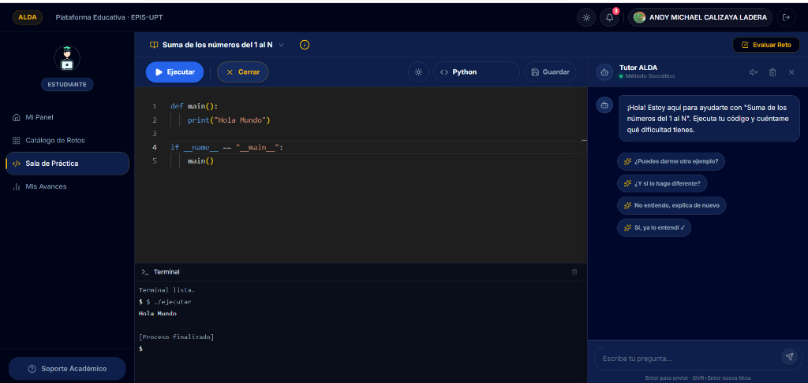
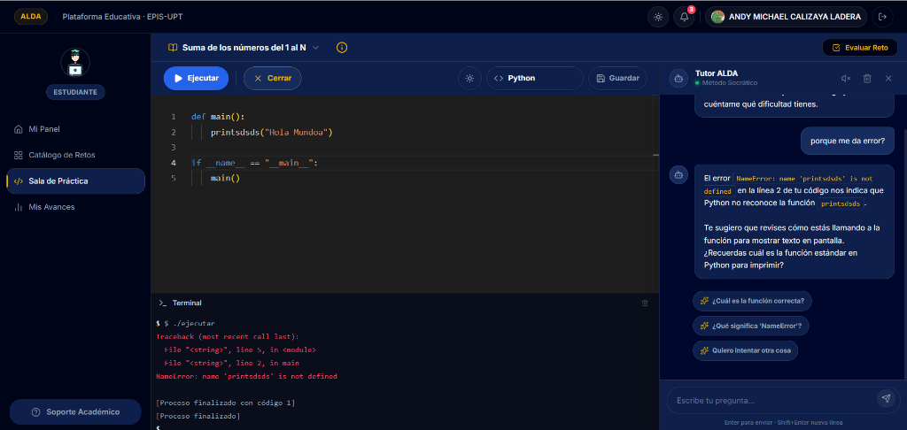
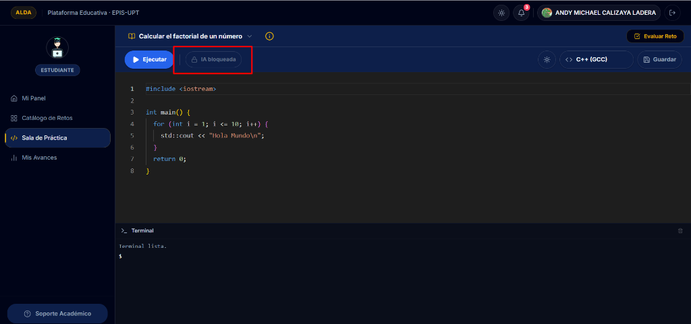

# Pruebas funcionales

> Documento de prueba funcional del caso CP-32. Se conservan los datos, las tablas, los resultados y las capturas de evidencia.

## Caso de prueba CP-32 — Solicitar guía al tutor inteligente

| Campo | Detalle |
|---|---|
| Caso N° | CP-32 |
| Caso de uso | Solicitar guía al tutor inteligente |
| Versión de ejecución | v1.0 |
| Fecha de ejecución | 24/11/2026 |
| Hora de ejecución | 11:30 a.m. |
| Módulo del sistema | Estudiante |

### Descripción de caso

Este caso de prueba verifica que el estudiante pueda declarar su intención, hacer clic en "Pedir ayuda" y recibir una guía contextual del tutor IA directamente en la interfaz del editor. El objetivo es comprobar que el panel del Tutor ALDA se abra correctamente desde la Sala de Práctica, que el estudiante pueda enviar su consulta mediante las sugerencias predefinidas, y que el tutor responda con orientación pedagógica basada en el método socrático sin revelar la solución directa.

### 1. Caso de Prueba

**Tipo de prueba:** Funcional.

#### a. Precondiciones que deben cumplir para realizar la prueba

1. El sistema (plataforma ALDA) debe estar desplegado y accesible desde un navegador web.
2. Debe existir una cuenta de estudiante con correo `@virtual.upt.pe` registrada y activa.
3. La API Key de Gemini debe estar configurada y activa en el panel de administración.
4. Debe existir al menos un laboratorio publicado por un docente.
5. El navegador debe tener JavaScript habilitado.
6. La conexión a internet debe estar activa.
7. El CP-31 (Generación de Respuesta del Tutor IA) debe haberse ejecutado exitosamente.

#### b. Pasos secuenciales para poder ejecutar

Representa la secuencia de pasos que deberán ser ejecutadas para verificar el caso de Prueba.

##### Flujo Normal: Solicitar guía al tutor IA desde el editor

| N° | Pasos | Resultado Esperado |
|---|---|---|
| 1 | Abrir el navegador e ingresar a la URL de la plataforma ALDA. Iniciar sesión con una cuenta de estudiante válida (`@virtual.upt.pe`) usando el botón "Iniciar sesión con Google". | El sistema autentica al usuario vía OAuth2 y redirige al dashboard del estudiante. |
| 2 | En el menú lateral izquierdo, hacer clic en "Sala de Práctica". | El sistema muestra la Sala de Práctica con el editor de código Monaco, la barra superior con el selector de laboratorio, y los botones "Ejecutar" y "Asistente" en la barra del editor. |
| 3 | Seleccionar un laboratorio activo desde el selector desplegable (ej. "Suma de los números del 1 al N"). | El laboratorio queda seleccionado y su título se muestra en la barra superior de la Sala de Práctica. |
| 4 | Escribir código Python con un error intencional en el editor (ej. `printsdsdsd("Hola Mundoa")` en lugar de `print("Hola Mundo")`) y hacer clic en el botón "Ejecutar". | El código se ejecuta y la Terminal inferior muestra el error: `NameError: name 'printsdsdsd' is not defined`. |
| 5 | Hacer clic en el botón "Asistente" (ícono de mensaje) en la barra del editor. Se abre el panel lateral derecho del "Tutor ALDA". | El panel del Tutor ALDA se abre mostrando el encabezado "Tutor ALDA — Método Socrático" con indicador verde de estado activo, el mensaje de bienvenida contextualizado al laboratorio activo: "¡Hola! Estoy aquí para ayudarte con «Suma de los números del 1 al N». Ejecuta tu código y cuéntame qué dificultad tienes." y sugerencias de seguimiento. |
| 6 | Hacer clic en la sugerencia "¿Por qué me da error?" (o escribir la intención en el campo de texto "Escribe tu pregunta..." y presionar Enter). | El mensaje del estudiante aparece como burbuja a la derecha. El Tutor ALDA muestra el indicador "Escribiendo..." y luego responde con una guía pedagógica contextualizada: identifica el error `NameError: name 'printsdsdsd' is not defined`, explica que Python no reconoce la función `printsdsdsd`, sugiere revisar el nombre de la función y pregunta al estudiante si recuerda cuál es la función estándar en Python para imprimir. Debajo de la respuesta aparecen sugerencias de seguimiento como "¿Cuál es la función correcta?", "¿Qué significa 'NameError'?" y "Quiero intentar otra cosa". |

**Evidencias del flujo normal:**

##### Flujo Alternativo: Asistente bloqueado en modo Examen

| N° | Pasos | Resultado Esperado |
|---|---|---|
| 1 | Seleccionar un laboratorio configurado en modo Examen (ej. "Calcular el factorial de un número") desde el selector de laboratorios. | El laboratorio en modo examen queda seleccionado y se muestra en la barra superior. |
| 2 | Observar que en la barra del editor, el botón "Asistente" ha sido reemplazado por el indicador "IA bloqueada" con un ícono de candado. | El sistema muestra el texto "IA bloqueada" con el ícono de candado (🔒) en lugar del botón "Asistente", impidiendo el acceso al Tutor ALDA durante el examen. |

**Evidencia:**

#### c. Post condiciones que deben cumplirse para la realización de la prueba

- El estudiante ha abierto correctamente el panel del Tutor ALDA desde la Sala de Práctica.
- El tutor IA ha respondido con una guía pedagógica contextualizada al código y al error del estudiante.
- La respuesta del tutor sigue el método socrático: formula preguntas reflexivas sin revelar la solución directa.
- El intento de consulta ha quedado registrado en la base de datos (tabla `attempts`).
- En modo examen, el asistente IA permanece correctamente bloqueado.

### 2. RESULTADOS DE LA PRUEBA

| Defectos y desviaciones encontradas en las pruebas | Resultado (marcar x) |
|---|---|
| La prueba se realizó exitosamente sin encontrar algún error o bug durante la ejecución de esta en sus diferentes escenarios. El panel del Tutor ALDA se abre correctamente, responde con guía pedagógica contextualizada al código y al error del estudiante, y se bloquea adecuadamente en modo examen. | **[x] Con éxito** [ ] Paralizada [ ] Suspendida |

### Observaciones generales

Ninguna.

### Responsable de Prueba

**Primer responsable**

- Nombre: Andy Calizaya
- Fecha: 24/11/2026
- Firma:

**Segundo responsable**

- Nombre: Gregory Huanca Merma
- Fecha: 24/11/2026
- Firma:

---
