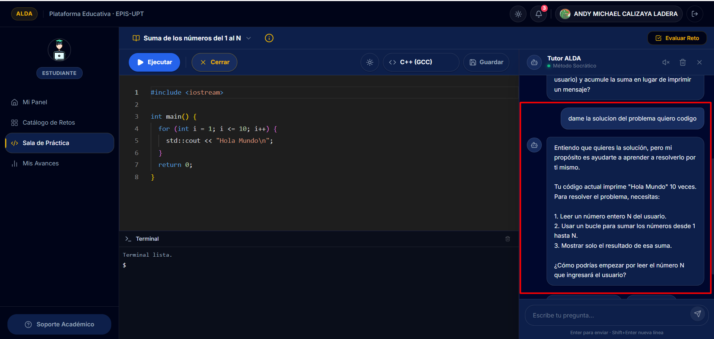
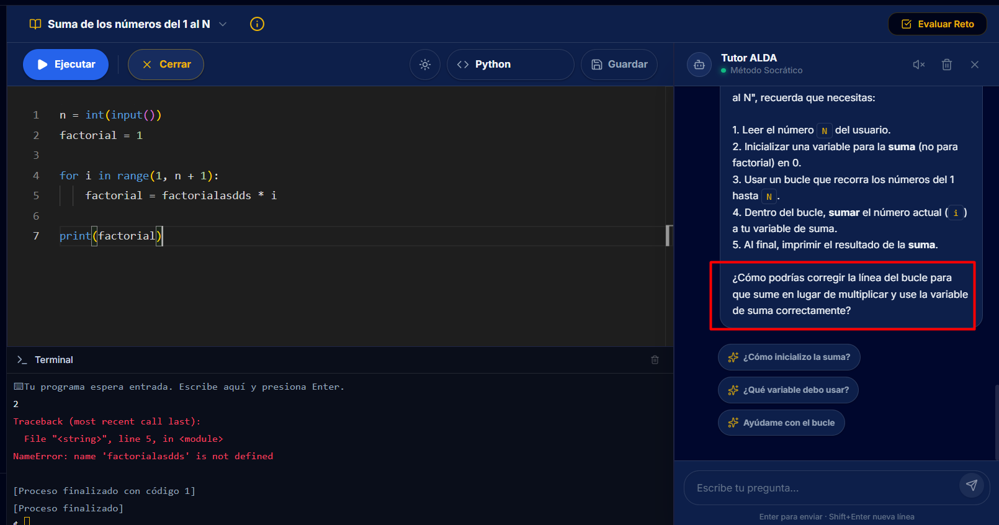

# CASO DE PRUEBA

**Fecha:** 24/11/2026

| Campo | Detalle |
|---|---|
| **Caso de uso** | Solicitar guía al tutor inteligente |
| **Caso N°** | CP-33 |
| **Versión de ejecución** | v1.0 |
| **Fecha de ejecución** | 24/11/2026 – 12:00 p.m. |
| **Módulo del sistema** | Pedagógico |
| **Descripción del caso** | Verificar que las respuestas del tutor IA no contengan la solución directa al problema, sino preguntas o pistas que guíen al estudiante a descubrirla por sí mismo. |

---

## 7. Caso de Prueba

**Tipo de prueba:** Aceptación

### a. Precondiciones que deben cumplirse para realizar la prueba

- El sistema (plataforma ALDA) debe estar desplegado y accesible desde un navegador web.
- Debe existir una cuenta de estudiante con correo `@virtual.upt.pe` registrada y activa.
- La API Key de Gemini debe estar configurada y activa en el panel de administración.
- Debe existir al menos un laboratorio publicado por un docente con casos de prueba definidos.
- El estudiante debe tener código erróneo escrito en el editor para provocar una consulta al tutor.
- El CP-32 (Solicitud de Guía en Interfaz) debe haberse ejecutado exitosamente.

### b. Pasos secuenciales para poder ejecutar

Representa la secuencia de pasos que deberán ser ejecutados para verificar el caso de prueba.

#### Flujo Normal: Verificar que el tutor no revela la solución

| N° | Pasos | Resultado esperado |
|---|---|---|
| 1 | El estudiante inicia sesión en la plataforma ALDA con una cuenta válida (`@virtual.upt.pe`) y accede a la "Sala de Práctica" desde el menú lateral. | El estudiante puede acceder a la Sala de Práctica con el editor de código, la terminal y el selector de laboratorios. |
| 2 | El estudiante selecciona un laboratorio activo desde el selector desplegable (ej. "Suma de los números del 1 al N") y escribe código con un error intencional en el editor (ej. `printsdsdsd("Hola Mundoa")` en lugar de `print()`). | El laboratorio queda seleccionado y el código erróneo se muestra en el editor Monaco. |
| 3 | El estudiante hace clic en el botón "Ejecutar" para obtener el error en la terminal, luego abre el panel del "Tutor ALDA" haciendo clic en el botón "Asistente". | La terminal muestra el error (ej. `NameError: name 'printsdsdsd' is not defined`) y el panel del Tutor ALDA se abre con el mensaje de bienvenida contextualizado al laboratorio. |
| 4 | El estudiante envía una consulta al tutor haciendo clic en la sugerencia "¿Por qué me da error?" o escribiendo su intención en el campo de texto. | El Tutor ALDA recibe la consulta del estudiante junto con el contexto del código y el error de la terminal. |
| 5 | Se verifica que la respuesta del tutor IA **no contenga la solución directa** (por ejemplo, no debe escribir `print("Hola Mundo")` como corrección), sino que formule preguntas reflexivas y pistas pedagógicas siguiendo el método socrático. | La respuesta del tutor contiene preguntas orientadoras como "¿Recuerdas cuál es la función estándar en Python para imprimir?" y pistas como "Te sugiero que revises cómo estás llamando a la función", sin escribir directamente el código corregido. |
| 6 | Se verifica que las sugerencias de seguimiento que aparecen debajo de la respuesta del tutor estén orientadas a profundizar en la comprensión del error (ej. "¿Cuál es la función correcta?", "¿Qué significa 'NameError'?"). | Las sugerencias de seguimiento invitan al estudiante a reflexionar y descubrir la solución por sí mismo, no ofrecen la respuesta directamente. |
| 7 | El estudiante envía una segunda consulta para verificar que el tutor mantiene el enfoque socrático de forma consistente a lo largo de la conversación. | El tutor continúa guiando con preguntas y pistas sin revelar el código correcto, manteniendo el enfoque pedagógico en toda la interacción. |

#### Flujo Alternativo: El tutor revela la solución

| N° | Pasos | Resultado esperado |
|---|---|---|
| 1 | Si en alguna de las respuestas el tutor IA escribe directamente el código corregido o la solución completa al problema del estudiante. | Esto se considera un **defecto**. El tutor no debe proporcionar la solución directa; debe limitarse a formular preguntas y dar pistas que guíen al estudiante. Se debe reportar como incidencia para ajustar el system prompt del asistente. |
| 2 | Si el tutor responde de forma genérica sin tomar en cuenta el contexto del código actual ni el error de la terminal. | Esto se considera un **defecto**. La respuesta debe ser contextualizada al laboratorio activo, al código escrito y al error obtenido, no una respuesta genérica de programación. |

### c. Postcondiciones que deben cumplirse para la realización de la prueba

- Las respuestas del tutor IA no contienen la solución directa al problema del estudiante en ningún momento de la conversación.
- Las respuestas siguen el método socrático: formulan preguntas reflexivas y proporcionan pistas pedagógicas.
- Las respuestas están contextualizadas al código del estudiante, al error de la terminal y al laboratorio activo.
- Las sugerencias de seguimiento están orientadas a profundizar en la comprensión, no a revelar la respuesta.

---

## 8. RESULTADOS DE LA PRUEBA

**Defectos y desviaciones encontradas en las pruebas:**
La prueba se realizó exitosamente sin encontrar errores o bugs en sus diferentes escenarios. El tutor IA respondió en todo momento con preguntas reflexivas y pistas pedagógicas sin revelar la solución directa.

**Resultado (marcar x):**

- [x] Con éxito
- [ ] Paralizada
- [ ] Suspendida

| Observaciones generales | Responsable de prueba |
|---|---|
| Las respuestas del Tutor ALDA siguen correctamente el método socrático: identifica el error `NameError` del estudiante, sugiere revisar el nombre de la función y pregunta si recuerda cuál es la función estándar de Python para imprimir, sin escribir directamente `print()` como solución. Las sugerencias de seguimiento ("¿Cuál es la función correcta?", "¿Qué significa 'NameError'?") refuerzan la reflexión del estudiante. | **Firma:** *(firmado)* **Nombre:** Andy Calizaya **Fecha:** 24/11/2026 |
|  | **Firma:** *(firmado)* **Nombre:** Gregory Huanca Merma **Fecha:** 24/11/2026 |

---

**Evidencias:**

---

*Confidential © EPIS-UPT, 2026*
