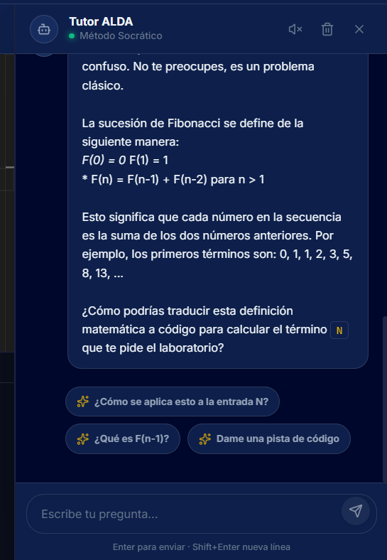

# Pruebas funcionales

> Documento de prueba funcional del caso CP-37. Se conservan los datos, las tablas, los resultados y las capturas de evidencia.

## Caso de prueba CP-37 — Calificar respuesta del tutor de IA

| Campo | Detalle |
|---|---|
| Caso N° | CP-37 |
| Caso de uso | Calificar respuesta del tutor de IA |
| Versión de ejecución | v1.0 |
| Fecha de ejecución | 24/11/2026 |
| Hora de ejecución | 7:00 p.m. |
| Módulo del sistema | Estudiante |

### Descripción de caso

Este caso de prueba verifica que el estudiante pueda calificar la respuesta del tutor IA seleccionando una valoración positiva o negativa y que esta quede registrada correctamente en el sistema. El objetivo es comprobar que los botones de calificación "¿Fue útil?" (👍 Sí / 👎 No) funcionen correctamente debajo de cada respuesta del tutor y que la calificación se envíe al Backend.

### 1. Caso de Prueba

**Tipo de prueba:** Funcional.

#### a. Precondiciones que deben cumplir para realizar la prueba

1. El sistema (plataforma ALDA) debe estar desplegado y accesible desde un navegador web.
2. Debe existir una cuenta de estudiante con correo `@virtual.upt.pe` registrada y activa.
3. La API Key de Gemini debe estar configurada y activa en el panel de administración.
4. Debe existir al menos un laboratorio publicado por un docente.
5. El estudiante debe haber recibido al menos una respuesta del tutor IA para poder calificarla.
6. El CP-36 (Almacenamiento de Calificación) debe haberse ejecutado exitosamente.

#### b. Pasos secuenciales para poder ejecutar

Representa la secuencia de pasos que deberán ser ejecutadas para verificar el caso de Prueba.

##### Flujo Normal: Calificar respuesta del tutor como útil

| N° | Pasos | Resultado Esperado |
|---|---|---|
| 1 | Abrir el navegador e ingresar a la URL de la plataforma ALDA. Iniciar sesión con una cuenta de estudiante válida (`@virtual.upt.pe`). | El sistema autentica al usuario vía OAuth2 y redirige al dashboard del estudiante. |
| 2 | En el menú lateral, hacer clic en "Sala de Práctica". Seleccionar un laboratorio activo, escribir código en el editor y hacer clic en el botón "Asistente" para abrir el panel del Tutor ALDA. | El panel del Tutor ALDA se abre mostrando el encabezado "Tutor ALDA — Método Socrático" con el indicador verde de estado activo. |
| 3 | Enviar una consulta al tutor (ej. hacer clic en la sugerencia "¿Por qué me da error?" o escribir una pregunta en el campo de texto). Esperar la respuesta del tutor. | El tutor responde con una guía pedagógica. Debajo de la respuesta aparece la sección de calificación: el texto **"¿Fue útil?"** con dos botones: **"👍 Sí"** y **"👎 No"**. |
| 4 | Hacer clic en el botón **"👍 Sí"** para calificar la respuesta como útil. | Aparece el toast **"Marcado como útil ✔"** (duración 1.5s). El botón "👍 Sí" se resalta con color dorado y fondo dorado transparente. Ambos botones quedan **deshabilitados** (cursor no clickeable). La calificación se envía al Backend vía `PUT /api/student/attempts/{attempt_id}/rate` con valor `1`. |

**Evidencia del flujo normal:**

##### Flujo Alternativo: Calificar respuesta como no útil

| N° | Pasos | Resultado Esperado |
|---|---|---|
| 1 | Tras recibir una respuesta diferente del tutor, hacer clic en el botón **"👎 No"**. | Aparece el toast **"Gracias por tu opinión"** (duración 1.5s). El botón "👎 No" se resalta con color rojo. Ambos botones quedan deshabilitados. La calificación se envía al Backend con valor `-1`. |

#### c. Post condiciones que deben cumplirse para la realización de la prueba

- La calificación del estudiante ha sido emitida correctamente (👍 o 👎).
- El Backend ha recibido y almacenado la calificación vía `PUT /api/student/attempts/{attempt_id}/rate`.
- Los botones de calificación han quedado deshabilitados después de la calificación.
- La calificación se ha guardado en `localStorage` bajo la clave `alda_chat_ratings` para persistir en la sesión.

### 2. RESULTADOS DE LA PRUEBA

| Defectos y desviaciones encontradas en las pruebas | Resultado (marcar x) |
|---|---|
| La prueba se realizó exitosamente sin encontrar algún error o bug durante la ejecución. Los botones de calificación "¿Fue útil?" funcionan correctamente, envían la calificación al Backend y se deshabilitan después de la emisión. | **[x] Con éxito** [ ] Paralizada [ ] Suspendida |

### Observaciones generales

Ninguna.

### Responsable de Prueba

**Primer responsable**

- Nombre: Andy Calizaya
- Fecha: 24/11/2026
- Firma:

**Segundo responsable**

- Nombre: Gregory Huanca Merma
- Fecha: 24/11/2026
- Firma:

---
