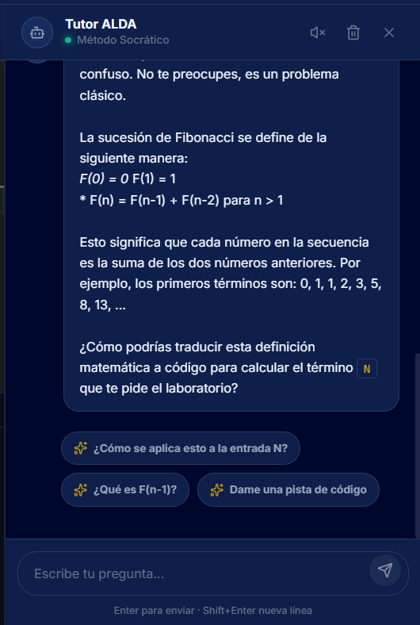

# CASO DE PRUEBA

**Fecha:** 24/11/2026

| Campo | Detalle |
|---|---|
| **Caso de uso** | Calificar respuesta del tutor de IA |
| **Caso N°** | CP-38 |
| **Versión de ejecución** | v1.0 |
| **Fecha de ejecución** | 24/11/2026 – 7:10 p.m. |
| **Módulo del sistema** | Integridad de Datos |
| **Descripción del caso** | Confirmar que el sistema no permita que un estudiante califique dos veces la misma respuesta del tutor, y que la interfaz deshabilite el control de calificación una vez emitida. |

---

## 7. Caso de Prueba

**Tipo de prueba:** Aceptación

### a. Precondiciones que deben cumplirse para realizar la prueba

- El sistema (plataforma ALDA) debe estar desplegado y accesible desde un navegador web.
- Debe existir una cuenta de estudiante con correo `@virtual.upt.pe` registrada y activa.
- El estudiante debe haber recibido al menos una respuesta del tutor IA y haberla calificado previamente.
- El CP-37 (Calificación de Respuesta del Tutor) debe haberse ejecutado exitosamente.

### b. Pasos secuenciales para poder ejecutar

Representa la secuencia de pasos que deberán ser ejecutados para verificar el caso de prueba.

#### Flujo Normal: Verificar que no se permite doble calificación

| N° | Pasos | Resultado esperado |
|---|---|---|
| 1 | El estudiante inicia sesión en la plataforma ALDA y accede a la "Sala de Práctica". Abre el panel del Tutor ALDA y envía una consulta para recibir una respuesta del tutor. | El tutor responde con una guía pedagógica y debajo aparecen los botones "¿Fue útil?" (👍 Sí / 👎 No). |
| 2 | El estudiante califica la respuesta haciendo clic en "👍 Sí" (o "👎 No"). Se muestra el toast de confirmación. | El botón seleccionado se resalta visualmente y **ambos botones** quedan deshabilitados (`disabled={!!ratings[msg.id]}`). El cursor cambia a `cursor-default` indicando que no son clickeables. |
| 3 | El estudiante intenta hacer clic en el otro botón (ej. si calificó "👍 Sí", intenta clic en "👎 No"). | El botón **no responde** al clic. La calificación original permanece sin cambios. No se envía ninguna solicitud adicional al Backend ya que la condición `if (ratings[msgId]) return` previene la ejecución. |
| 4 | El estudiante recarga la página (F5) y vuelve al panel del Tutor ALDA. | La calificación **persiste** gracias al almacenamiento en `localStorage` bajo la clave `alda_chat_ratings`. Los botones de la respuesta previamente calificada siguen deshabilitados y el botón calificado mantiene su resaltado visual. |
| 5 | Se verifica que nuevas respuestas del tutor (aún no calificadas) sí muestren los botones "¿Fue útil?" habilitados y funcionales. | Las nuevas respuestas tienen los botones habilitados, confirmando que la deshabilitación es por mensaje individual, no global. |

### c. Postcondiciones que deben cumplirse para la realización de la prueba

- Una vez emitida la calificación, ambos botones (👍 y 👎) quedan permanentemente deshabilitados para esa respuesta específica.
- No se puede cambiar ni duplicar la calificación de una respuesta ya calificada.
- La calificación persiste entre recargas de página gracias al `localStorage`.
- Nuevas respuestas del tutor mantienen sus botones habilitados independientemente.

---

## 8. RESULTADOS DE LA PRUEBA

**Defectos y desviaciones encontradas en las pruebas:**
La prueba se realizó exitosamente sin encontrar errores o bugs en sus diferentes escenarios. El sistema impide correctamente la doble calificación de una misma respuesta del tutor.

**Resultado (marcar x):**

- [x] Con éxito
- [ ] Paralizada
- [ ] Suspendida

| Observaciones generales | Responsable de prueba |
|---|---|
| El sistema impide la doble calificación mediante la condición `if (ratings[msgId]) return` que verifica si ya existe una calificación para ese mensaje. Los botones se deshabilitan con `disabled={!!ratings[msg.id]}` y la calificación persiste en `localStorage` bajo `alda_chat_ratings`, sobreviviendo recargas de página. Las nuevas respuestas mantienen botones habilitados de forma independiente. | **Firma:** *(firmado)* **Nombre:** Andy Calizaya **Fecha:** 24/11/2026 |
|  | **Firma:** *(firmado)* **Nombre:** Gregory Huanca Merma **Fecha:** 24/11/2026 |

---

**Evidencia:**

---

*Confidential © EPIS-UPT, 2026*
