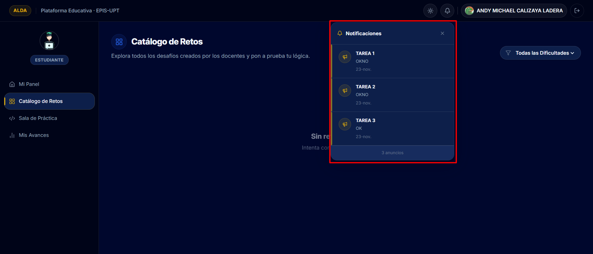

# Pruebas funcionales

> Documento de prueba funcional del caso CP-47. Se conservan los datos, las tablas, los resultados y las capturas de evidencia.

## Caso de prueba CP-47 — Visualización de Anuncios del Docente

| Campo | Detalle |
|---|---|
| Caso N° | CP-47 |
| Caso de uso | Visualizar anuncios del docente |
| Versión de ejecución | v1.0 |
| Fecha de ejecución | 23/11/2026 |
| Hora de ejecución | 4:00 p.m. |
| Módulo del sistema | Estudiante |

### Descripción de caso

Este caso de prueba verifica que el estudiante autenticado pueda ver en su dashboard la lista de anuncios publicados por el docente, ordenados del más reciente al más antiguo. El objetivo es comprobar que la sección de anuncios sea visible, que cada anuncio muestre su título, contenido y fecha de publicación, y que el orden cronológico sea correcto.

### 1. Caso de Prueba

**Tipo de prueba:** Funcional.

#### a. Precondiciones que deben cumplir para realizar la prueba

1. El sistema (plataforma ALDA) debe estar desplegado y accesible desde un navegador web.
2. Debe existir una cuenta de estudiante con correo `@virtual.upt.pe` registrada y activa.
3. Un docente debe haber publicado al menos 3 anuncios previamente.
4. El navegador debe tener JavaScript habilitado.
5. La conexión a internet debe estar activa.
6. El CP-46 (Validación de Estructura del Anuncio) debe haberse ejecutado exitosamente.

#### b. Pasos secuenciales para poder ejecutar

Representa la secuencia de pasos que deberán ser ejecutadas para verificar el caso de Prueba.

##### Flujo Normal: Visualizar anuncios del docente en el dashboard

| N° | Pasos | Resultado Esperado |
|---|---|---|
| 1 | Abrir el navegador e ingresar a la URL de la plataforma ALDA. | El sistema muestra la página de inicio de sesión con el botón "Iniciar sesión con Google". |
| 2 | Hacer clic en el botón "Iniciar sesión con Google" e iniciar sesión con una cuenta de estudiante válida (`@virtual.upt.pe`). | El sistema autentica al usuario vía OAuth2 y redirige al dashboard del estudiante. |
| 3 | En el dashboard del estudiante, localizar la sección de "Anuncios". | Se muestra una sección visible con la lista de anuncios publicados por el docente. |
| 4 | Verificar que cada anuncio muestre su título, contenido (o resumen) y fecha de publicación. | Cada anuncio de la lista presenta correctamente su título, contenido y fecha. |
| 5 | Verificar que los anuncios estén ordenados del más reciente al más antiguo. | El primer anuncio de la lista corresponde al más reciente y el último al más antiguo. |
| 6 | Contar los anuncios visibles y verificar que se muestren al menos 3 anuncios. | Se visualizan al menos 3 anuncios publicados por el docente. |

**Evidencias del flujo normal:**

##### Flujo Alternativo: Dashboard sin anuncios publicados

| N° | Pasos | Resultado Esperado |
|---|---|---|
| 1 | Iniciar sesión como estudiante en un entorno donde el docente no haya publicado ningún anuncio. | El sistema autentica al usuario y redirige al dashboard. |
| 2 | Localizar la sección de anuncios en el dashboard. | La sección de anuncios se muestra vacía o con un mensaje informativo como "No hay anuncios disponibles". |

**Evidencia:**

##### Flujo Alternativo: Verificación de orden con anuncios de distintas fechas

| N° | Pasos | Resultado Esperado |
|---|---|---|
| 1 | Iniciar sesión como estudiante en un entorno donde existan anuncios publicados en diferentes fechas. | El sistema autentica al usuario y redirige al dashboard. |
| 2 | Revisar la sección de anuncios y comparar las fechas de publicación de cada anuncio. | Los anuncios se muestran estrictamente ordenados del más reciente al más antiguo, sin excepciones. |

**Evidencia:**

#### c. Post condiciones que deben cumplirse para la realización de la prueba

- El estudiante ha visualizado correctamente todos los anuncios publicados por el docente.
- Los anuncios se muestran ordenados del más reciente al más antiguo.
- No se alteró ningún dato; la operación es de solo lectura.
- La sección de anuncios es accesible y visible desde el dashboard del estudiante.

### 2. RESULTADOS DE LA PRUEBA

| Defectos y desviaciones encontradas en las pruebas | Resultado (marcar x) |
|---|---|
| La prueba se realizó exitosamente sin encontrar algún error o bug durante la ejecución de esta en sus diferentes escenarios. Los anuncios se visualizan correctamente en el dashboard del estudiante, con el orden cronológico adecuado. | **[x] Con éxito** [ ] Paralizada [ ] Suspendida |

### Observaciones generales

Ninguna.

### Responsable de Prueba

**Primer responsable**

- Nombre: Andy Calizaya
- Fecha: 23/11/2026
- Firma:

**Segundo responsable**

- Nombre: Gregory Huanca Merma
- Fecha: 23/11/2026
- Firma:

---
