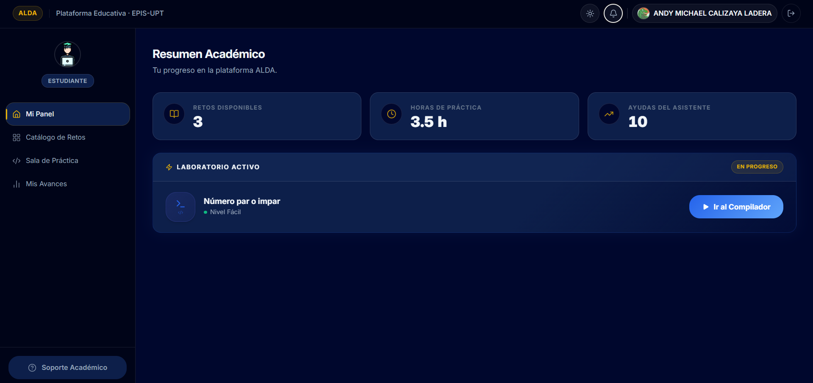

# CASO DE PRUEBA

**Fecha:** 24/11/2026

| Campo | Detalle |
|---|---|
| **Caso de uso** | Visualizar anuncios del docente |
| **Caso N°** | CP-48 |
| **Versión de ejecución** | v1.0 |
| **Fecha de ejecución** | 24/11/2026 – 12:30 p.m. |
| **Módulo del sistema** | Seguridad |
| **Descripción del caso** | Confirmar que un usuario con rol "Estudiante" no pueda crear, editar ni eliminar anuncios, y que el Backend rechace cualquier intento con error 403. |

---

## 7. Caso de Prueba

**Tipo de prueba:** Aceptación

### a. Precondiciones que deben cumplirse para realizar la prueba

- El sistema (plataforma ALDA) debe estar desplegado y accesible desde un navegador web.
- Debe existir una cuenta de estudiante con correo `@virtual.upt.pe` registrada y activa.
- Debe existir al menos un anuncio publicado previamente por un docente.
- El CP-47 (Visualización de Anuncios del Docente) debe haberse ejecutado exitosamente.

### b. Pasos secuenciales para poder ejecutar

Representa la secuencia de pasos que deberán ser ejecutados para verificar el caso de prueba.

#### Flujo Normal: Verificar restricción de creación de anuncios para estudiantes

| N° | Pasos | Resultado esperado |
|---|---|---|
| 1 | El estudiante inicia sesión en la plataforma ALDA con una cuenta válida (`@virtual.upt.pe`). | El estudiante accede al dashboard y el menú lateral muestra únicamente las opciones de estudiante: "Mi Panel", "Catálogo de Retos", "Sala de Práctica" y "Mis Avances". No aparece la opción "Gestión de Notificaciones" ni ninguna sección de docente. |
| 2 | Se verifica que en la interfaz del estudiante no exista ningún botón, formulario ni opción para crear, editar o eliminar anuncios. | La interfaz del estudiante solo muestra los anuncios en modo lectura dentro del dashboard (sección de anuncios). No se muestran botones de "Publicar", "Editar" ni "Eliminar" (ícono de papelera). |
| 3 | Desde las herramientas del navegador (DevTools > Console o una herramienta como Postman), se realiza una solicitud HTTP POST al endpoint `/api/teacher/announcements` con las credenciales de la sesión del estudiante, enviando un título y contenido de prueba. | El Backend rechaza la solicitud con un código de estado **HTTP 403 Forbidden** y devuelve el mensaje: `"Acceso denegado: se requiere rol teacher o admin"`. El anuncio no se crea en la base de datos. |
| 4 | Se realiza una solicitud HTTP DELETE al endpoint `/api/teacher/announcements/{id}` con las credenciales del estudiante, usando el ID de un anuncio existente. | El Backend rechaza la solicitud con un código de estado **HTTP 403 Forbidden** y devuelve el mensaje: `"Acceso denegado: se requiere rol teacher o admin"`. El anuncio no se elimina de la base de datos. |
| 5 | Se verifica en la base de datos que ningún anuncio fue creado ni eliminado como resultado de los intentos anteriores. | Los registros de anuncios en la base de datos permanecen intactos, sin modificaciones. |

#### Flujo Alternativo: Manipulación de headers

| N° | Pasos | Resultado esperado |
|---|---|---|
| 1 | Si el estudiante intenta enviar la solicitud POST manipulando el header `X-User-ID` con el ID de un docente, pero manteniendo su propia cookie de sesión. | El Backend valida la identidad desde la cookie de sesión, no desde el header. La solicitud es rechazada con error **403** porque el rol real del usuario autenticado es "student". |
| 2 | Si el estudiante intenta acceder directamente a la URL del panel de gestión de notificaciones del docente mediante la barra de direcciones del navegador. | El sistema redirige al estudiante a su dashboard o muestra una página de acceso denegado, ya que las rutas del docente están protegidas por el sistema de roles del Frontend. |

### c. Postcondiciones que deben cumplirse para la realización de la prueba

- El estudiante no puede crear, editar ni eliminar anuncios desde la interfaz ni mediante solicitudes HTTP directas.
- Todos los endpoints de anuncios del docente (`/api/teacher/announcements`) están protegidos por la dependencia `verify_teacher_role`, que rechaza con **HTTP 403** a usuarios con rol "student".
- Los datos de anuncios en la base de datos permanecen inalterados tras los intentos del estudiante.

---

## 8. RESULTADOS DE LA PRUEBA

**Defectos y desviaciones encontradas en las pruebas:**
La prueba se realizó exitosamente sin encontrar errores o bugs en sus diferentes escenarios. Los endpoints del docente rechazan correctamente las solicitudes de usuarios con rol estudiante con error 403.

**Resultado (marcar x):**

- [x] Con éxito
- [ ] Paralizada
- [ ] Suspendida

| Observaciones generales | Responsable de prueba |
|---|---|
| La interfaz del estudiante no expone opciones de gestión de anuncios. Los endpoints `/api/teacher/announcements` (POST y DELETE) están protegidos por `verify_teacher_role` que valida el rol desde la sesión autenticada, rechazando con HTTP 403 y el mensaje "Acceso denegado: se requiere rol teacher o admin". Los datos permanecen intactos tras los intentos. | **Firma:** *(firmado)* **Nombre:** Andy Calizaya **Fecha:** 24/11/2026 |
|  | **Firma:** *(firmado)* **Nombre:** Gregory Huanca Merma **Fecha:** 24/11/2026 |

---

**Evidencias:**

---

*Confidential © EPIS-UPT, 2026*
