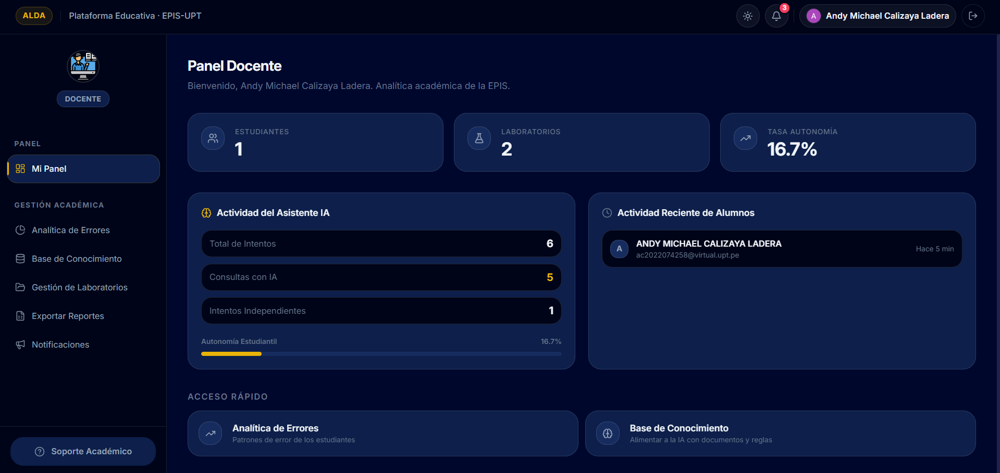
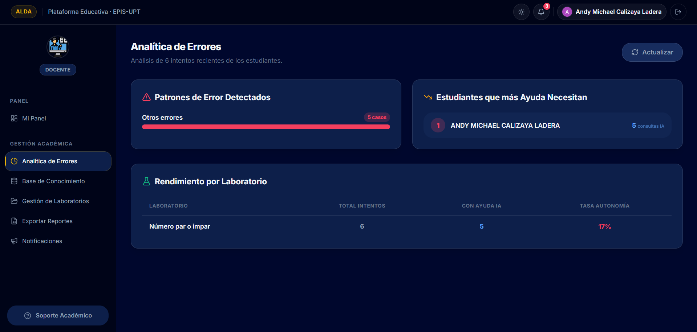
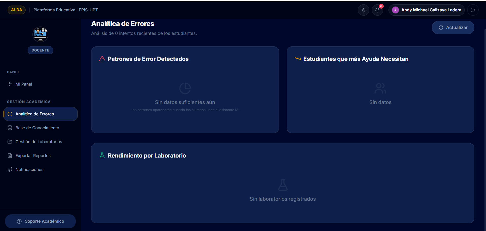

# Pruebas funcionales

> Documento de prueba funcional del caso CP-52. Se conservan los datos, las tablas, los resultados y las capturas de evidencia.

## Caso de prueba CP-52 — Visualización Panel Estadísticas de Clase

| Campo | Detalle |
|---|---|
| Caso N° | CP-52 |
| Caso de uso | Consultar panel de estadísticas de clase |
| Versión de ejecución | v1.0 |
| Fecha de ejecución | 23/11/2026 |
| Hora de ejecución | 5:00 p.m. |
| Módulo del sistema | Docente |

### Descripción de caso

Este caso de prueba verifica que el docente autenticado pueda ver en su panel las métricas agregadas de la clase: promedios, tasas de éxito y distribución de dificultades. El objetivo es comprobar que el panel de estadísticas presente datos correctos, actualizados y comprensibles para el docente.

### 1. Caso de Prueba

**Tipo de prueba:** Funcional.

#### a. Precondiciones que deben cumplir para realizar la prueba

1. El sistema (plataforma ALDA) debe estar desplegado y accesible desde un navegador web.
2. Debe existir una cuenta de docente con correo `@virtual.upt.pe` registrada y activa.
3. La base de datos debe contener datos de al menos 5 estudiantes con intentos registrados en distintos retos.
4. El navegador debe tener JavaScript habilitado.
5. La conexión a internet debe estar activa.
6. El CP-51 (Cálculo de Estadísticas de Clase) debe haberse ejecutado exitosamente.

#### b. Pasos secuenciales para poder ejecutar

Representa la secuencia de pasos que deberán ser ejecutadas para verificar el caso de Prueba.

##### Flujo Normal: Visualizar panel de estadísticas de clase

| N° | Pasos | Resultado Esperado |
|---|---|---|
| 1 | Abrir el navegador e ingresar a la URL de la plataforma ALDA. | El sistema muestra la página de inicio de sesión con el botón "Iniciar sesión con Google". |
| 2 | Hacer clic en el botón "Iniciar sesión con Google" e iniciar sesión con una cuenta de docente válida (`@virtual.upt.pe`). | El sistema autentica al usuario vía OAuth2 y redirige al panel del docente. |
| 3 | En el panel del docente, localizar y hacer clic en la sección de "Estadísticas de Clase" o "Dashboard de Estadísticas". | El sistema muestra el panel de estadísticas con las métricas agregadas de la clase. |
| 4 | Verificar que se muestre el promedio de intentos por estudiante. | El panel presenta el promedio de intentos calculado correctamente. |
| 5 | Verificar que se muestre la tasa de aprobación (porcentaje de retos completados exitosamente). | La tasa de éxito se muestra como un porcentaje coherente con los datos de la base de datos. |
| 6 | Verificar que se muestre la distribución de dificultades (retos más difíciles vs. más fáciles según la tasa de éxito). | Se presenta una visualización (tabla o gráfica) con la distribución de dificultad de los retos. |
| 7 | Verificar que las métricas reflejen datos de al menos 5 estudiantes registrados en la base de datos. | Las estadísticas agregadas consideran los datos de todos los estudiantes con actividad registrada. |

**Evidencias del flujo normal:**

##### Flujo Alternativo: Panel sin datos de estudiantes

| N° | Pasos | Resultado Esperado |
|---|---|---|
| 1 | Iniciar sesión como docente en un entorno donde no existan intentos registrados de estudiantes. | El sistema autentica al usuario y redirige al panel del docente. |
| 2 | Acceder a la sección de estadísticas de clase. | El panel se muestra vacío o con un mensaje informativo como "No hay datos suficientes para generar estadísticas" o muestra valores en 0. |

**Evidencia:**

##### Flujo Alternativo: Verificación de coherencia de datos

| N° | Pasos | Resultado Esperado |
|---|---|---|
| 1 | Iniciar sesión como docente y acceder al panel de estadísticas. | El panel muestra las métricas agregadas de la clase. |
| 2 | Comparar los valores mostrados en el panel con los registros reales de la base de datos (consultando PostgreSQL directamente si es posible). | Los promedios, tasas y distribuciones coinciden con los datos almacenados en la base de datos. |

**Evidencia:**

#### c. Post condiciones que deben cumplirse para la realización de la prueba

- El docente ha visualizado correctamente el panel de estadísticas de clase.
- Las métricas agregadas (promedios, tasas de éxito, distribución de dificultades) se muestran correctamente.
- No se alteró ningún dato; la operación es de solo lectura.
- El panel es accesible únicamente desde la sesión del docente.

### 2. RESULTADOS DE LA PRUEBA

| Defectos y desviaciones encontradas en las pruebas | Resultado (marcar x) |
|---|---|
| La prueba se realizó exitosamente sin encontrar algún error o bug durante la ejecución de esta en sus diferentes escenarios. El panel de estadísticas muestra correctamente los promedios, tasas de éxito y distribución de dificultades de la clase. | **[x] Con éxito** [ ] Paralizada [ ] Suspendida |

### Observaciones generales

Ninguna.

### Responsable de Prueba

**Primer responsable**

- Nombre: Andy Calizaya
- Fecha: 23/11/2026
- Firma:

**Segundo responsable**

- Nombre: Gregory Huanca Merma
- Fecha: 23/11/2026
- Firma:

---
