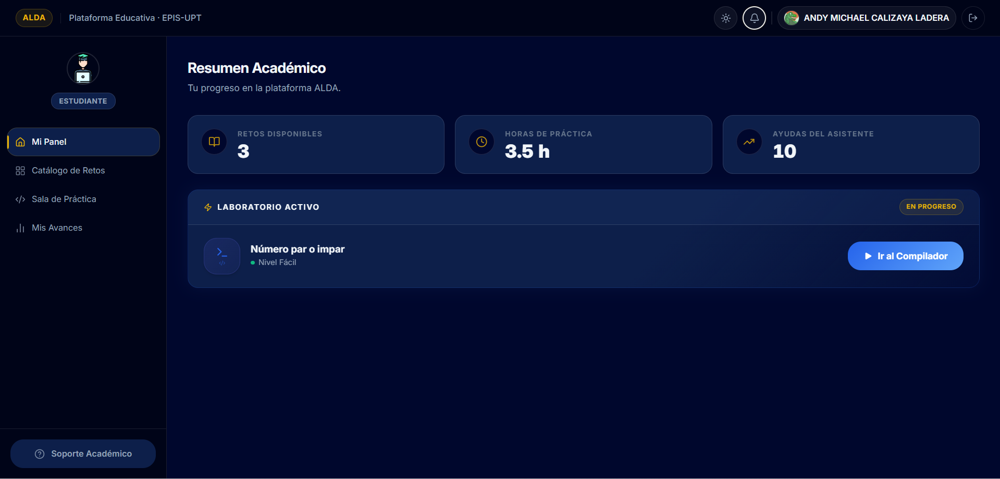

# CASO DE PRUEBA

**Fecha:** 24/11/2026

| Campo | Detalle |
|---|---|
| **Caso de uso** | Consultar panel de estadísticas de clase |
| **Caso N°** | CP-53 |
| **Versión de ejecución** | v1.0 |
| **Fecha de ejecución** | 24/11/2026 – 12:45 p.m. |
| **Módulo del sistema** | Seguridad |
| **Descripción del caso** | Confirmar que un usuario con rol "Estudiante" no pueda acceder al panel de estadísticas de clase, y que el sistema devuelva error 403 ante cualquier intento de acceso. |

---

## 7. Caso de Prueba

**Tipo de prueba:** Aceptación

### a. Precondiciones que deben cumplirse para realizar la prueba

- El sistema (plataforma ALDA) debe estar desplegado y accesible desde un navegador web.
- Debe existir una cuenta de estudiante con correo `@virtual.upt.pe` registrada y activa.
- Debe existir una cuenta de docente con datos de estudiantes en la base de datos para que las estadísticas estén disponibles.
- El CP-52 (Visualización Panel Estadísticas de Clase) debe haberse ejecutado exitosamente.

### b. Pasos secuenciales para poder ejecutar

Representa la secuencia de pasos que deberán ser ejecutados para verificar el caso de prueba.

#### Flujo Normal: Verificar restricción de acceso a estadísticas para estudiantes

| N° | Pasos | Resultado esperado |
|---|---|---|
| 1 | El estudiante inicia sesión en la plataforma ALDA con una cuenta válida (`@virtual.upt.pe`). | El estudiante accede al dashboard y el menú lateral muestra únicamente las opciones de estudiante: "Mi Panel", "Catálogo de Retos", "Sala de Práctica" y "Mis Avances". No aparece la sección "Panel Docente" ni las opciones de estadísticas de clase. |
| 2 | Se verifica que en la interfaz del estudiante no exista ninguna opción de menú, enlace ni botón que permita acceder al panel de estadísticas de clase (métricas agregadas, tasas de éxito, distribución de dificultades). | La interfaz del estudiante no incluye las secciones "Panel Docente", "Analítica de Errores" ni "Estadísticas de Clase" en el menú lateral ni en ninguna parte de la interfaz. |
| 3 | Desde las herramientas del navegador (DevTools > Console o Postman), se realiza una solicitud HTTP GET al endpoint `/api/teacher/stats` con las credenciales de la sesión del estudiante. | El Backend rechaza la solicitud con un código de estado **HTTP 403 Forbidden** y devuelve el mensaje: `"Acceso denegado: se requiere rol teacher o admin"`. No se devuelven datos de estadísticas. |
| 4 | Se realiza una solicitud HTTP GET al endpoint `/api/teacher/error-analytics` con las credenciales de la sesión del estudiante. | El Backend rechaza la solicitud con un código de estado **HTTP 403 Forbidden** y devuelve el mensaje: `"Acceso denegado: se requiere rol teacher o admin"`. No se devuelven datos de analítica de errores. |
| 5 | Se verifica que la respuesta del Backend no incluya ningún dato de estadísticas de clase, ni siquiera parcialmente, en el cuerpo de la respuesta de error. | El cuerpo de la respuesta 403 contiene únicamente el campo `detail` con el mensaje de acceso denegado, sin exponer datos sensibles de estadísticas. |

#### Flujo Alternativo: Acceso directo por URL

| N° | Pasos | Resultado esperado |
|---|---|---|
| 1 | Si el estudiante intenta acceder directamente a la ruta del panel docente escribiendo la URL en la barra de direcciones del navegador (ej. navegando manualmente a la vista de estadísticas). | El sistema redirige al estudiante a su dashboard o muestra las opciones correspondientes a su rol, ya que el Frontend filtra las rutas según el rol del usuario autenticado. |
| 2 | Si el estudiante intenta manipular el almacenamiento de sesión (`sessionStorage`) cambiando su rol a "teacher" para forzar la visualización del menú docente. | Incluso si el Frontend muestra las opciones, las solicitudes a los endpoints `/api/teacher/stats` y `/api/teacher/error-analytics` fallan con **403** porque el Backend valida el rol real desde la cookie de sesión, no desde el almacenamiento local. |

### c. Postcondiciones que deben cumplirse para la realización de la prueba

- El estudiante no puede acceder al panel de estadísticas de clase ni desde la interfaz ni mediante solicitudes HTTP directas.
- Todos los endpoints de estadísticas del docente (`/api/teacher/stats`, `/api/teacher/error-analytics`) están protegidos por la dependencia `verify_teacher_role`, que rechaza con **HTTP 403** a usuarios con rol "student".
- Ningún dato de estadísticas de clase es expuesto al estudiante en ningún escenario.

---

## 8. RESULTADOS DE LA PRUEBA

**Defectos y desviaciones encontradas en las pruebas:**
La prueba se realizó exitosamente sin encontrar errores o bugs en sus diferentes escenarios. Los endpoints de estadísticas del docente rechazan correctamente las solicitudes de usuarios con rol estudiante con error 403.

**Resultado (marcar x):**

- [x] Con éxito
- [ ] Paralizada
- [ ] Suspendida

| Observaciones generales | Responsable de prueba |
|---|---|
| La interfaz del estudiante no incluye opciones de acceso al panel de estadísticas de clase. Los endpoints `/api/teacher/stats` y `/api/teacher/error-analytics` están protegidos por `verify_teacher_role` que valida el rol desde la sesión autenticada, rechazando con HTTP 403 y el mensaje "Acceso denegado: se requiere rol teacher o admin". Ningún dato de estadísticas es expuesto al estudiante. | **Firma:** *(firmado)* **Nombre:** Andy Calizaya **Fecha:** 24/11/2026 |
|  | **Firma:** *(firmado)* **Nombre:** Gregory Huanca Merma **Fecha:** 24/11/2026 |

---

**Evidencias:**

---

*Confidential © EPIS-UPT, 2026*
