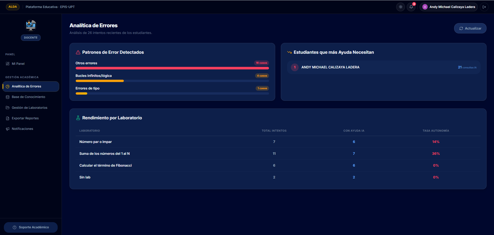

# Pruebas funcionales

> Documento de prueba funcional del caso CP-57, elaborado con las capturas proporcionadas.

## Caso de prueba CP-57 — Visualización Análisis de Errores

| Campo | Detalle |
|---|---|
| Caso N° | CP-57 |
| Caso de uso | Revisar análisis de errores frecuentes |
| Versión de ejecución | v1.0 |
| Fecha de ejecución | No indicada en las evidencias |
| Hora de ejecución | No indicada en las evidencias |
| Fecha de documentación | 27/11/2026 |
| Módulo del sistema | Docente |

### Descripción de caso

Verificar que el docente pueda visualizar los tipos de error más frecuentes de la clase, su frecuencia y los retos donde ocurren con mayor frecuencia.

### 1. Caso de Prueba

**Tipo de prueba:** Funcional.

#### a. Precondiciones que deben cumplir para realizar la prueba

1. Plataforma ALDA accesible desde un navegador web.
2. Sesión activa con rol docente.
3. Al menos 10 intentos fallidos registrados en la base de datos, según el catálogo. La captura muestra 26 intentos totales, pero no acredita cuántos fueron fallidos.
4. Retroalimentación del tutor IA registrada para visualizar los patrones de la implementación actual.
5. Dependencia: CP-56. Su ejecución no se acredita con estas capturas.

#### b. Pasos secuenciales para poder ejecutar

##### Flujo Normal: Consulta del análisis de errores

| N° | Pasos | Resultado Esperado |
|---|---|---|
| 1 | Iniciar sesión como docente y abrir "Analítica de Errores". | Se muestra el reporte de la clase. |
| 2 | Pulsar "Actualizar" y revisar "Patrones de Error Detectados". | Se muestran los tipos de error y su frecuencia. |
| 3 | Revisar "Rendimiento por Laboratorio" y comprobar la relación entre errores y retos. | Se identifican los retos donde ocurre con mayor frecuencia cada tipo de error. |

**Evidencia del flujo normal:**

#### c. Post condiciones que deben cumplirse para la realización de la prueba

- El docente visualiza los tipos de error y sus frecuencias.
- El reporte permite identificar los retos donde predomina cada tipo de error. Esta condición no se cumple en la vista capturada.

### 2. RESULTADOS DE LA PRUEBA

| Defectos y desviaciones encontradas en las pruebas | Resultado (marcar x) |
|---|---|
| El reporte muestra 26 intentos recientes y los patrones "Otros errores": 16 casos; "Bucles infinitos/lógica": 4 casos; "Errores de tipo": 1 caso. La tabla de laboratorios muestra intentos, consultas con ayuda IA y autonomía, pero no relaciona cada tipo de error con los retos donde ocurre. El requisito se cumple parcialmente. | [ ] Con éxito [ ] Paralizada [ ] Suspendida **[x] Con observaciones — cumplimiento parcial** |

### Observaciones generales

- La misma captura contiene los patrones y la tabla completa; no se requiere una segunda imagen.
- La tabla muestra: "Número par o impar" (7 intentos, 6 con IA, 14% de autonomía); "Suma de los números del 1 al N" (11, 7, 36%); "Calcular el término de Fibonacci" (6, 6, 0%); "Sin lab" (2, 2, 0%).
- Los 21 casos clasificados coinciden con las 21 consultas IA mostradas; esto no demuestra que existan 21 evaluaciones fallidas. La implementación clasifica la retroalimentación IA.
- Se requiere el desglose de tipos de error por reto para dar por satisfecho todo el alcance del catálogo. La ejecución queda documentada como finalizada con observaciones, sin aprobación completa.
- La fecha de documentación no sustituye la fecha de ejecución, que no fue proporcionada.

### Responsable de Prueba

**Primer responsable**

- Nombre: Andy Calizaya
- Fecha de ejecución: No indicada.
- Firma: Pendiente.

**Segundo responsable**

- Nombre: Gregory Huanca Merma
- Fecha de ejecución: No indicada.
- Firma: Pendiente.

---
