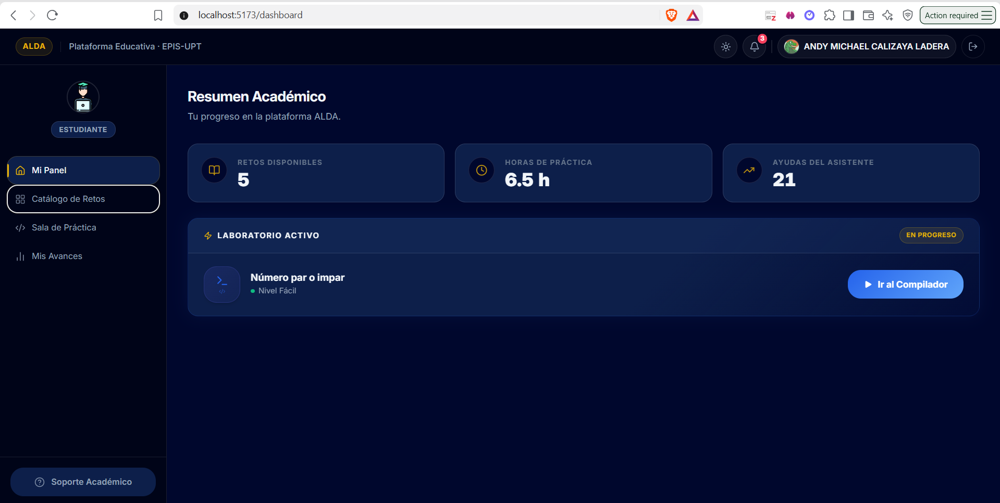
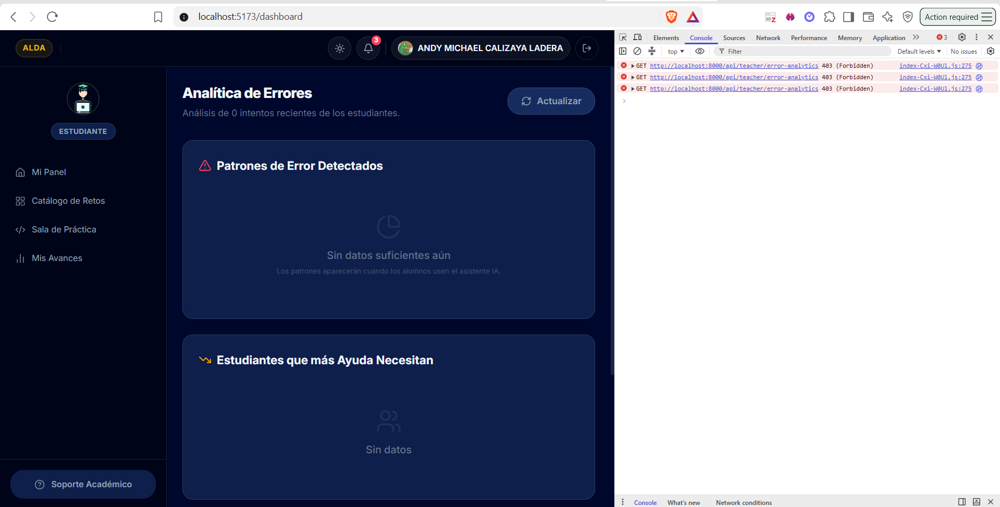

# CASO DE PRUEBA

**Fecha de documentación:** 27/11/2026

| Campo | Detalle |
|---|---|
| **Caso de uso** | Revisar análisis de errores frecuentes |
| **Caso N°** | CP-58 |
| **Versión de ejecución** | v1.0 |
| **Fecha de ejecución** | Fecha y hora no indicadas en las evidencias |
| **Módulo del sistema** | Seguridad |
| **Descripción del caso** | Confirmar que los estudiantes no puedan acceder al análisis de errores frecuentes de la clase, garantizando la confidencialidad de las métricas colectivas. |

---

## 7. Caso de Prueba

**Tipo de prueba:** Aceptación

### a. Precondiciones que deben cumplirse para realizar la prueba

- Plataforma ALDA accesible desde un navegador web.
- Sesión activa con rol estudiante.
- Datos de análisis disponibles para el docente, acreditados en la captura de CP-57.
- Herramientas de desarrollador del navegador disponibles para comprobar el rechazo HTTP.
- Dependencia: CP-57, ejecutado y documentado con observaciones.

### b. Pasos secuenciales para poder ejecutar

#### Flujo Normal: Restricción de acceso desde el menú

| N° | Pasos | Resultado esperado |
|---|---|---|
| 1 | Iniciar sesión como estudiante y abrir el dashboard. | Se muestra el rol "ESTUDIANTE". |
| 2 | Revisar el menú lateral. | Se muestran "Mi Panel", "Catálogo de Retos", "Sala de Práctica" y "Mis Avances", sin la opción "Analítica de Errores". |

#### Flujo Alternativo: Intento de acceso directo a la vista docente

| N° | Pasos | Resultado esperado |
|---|---|---|
| 1 | Con la sesión de estudiante, abrir F12 → Consola, ejecutar `sessionStorage.setItem('alda_active_tab', 'teacher/analytics');` y luego `location.reload();`. | El intento no permite obtener las métricas colectivas. |
| 2 | Revisar las solicitudes a `/api/teacher/error-analytics` en las herramientas de desarrollador. | El servidor rechaza la solicitud con HTTP 403 y no se muestran datos colectivos. |
| 3 | Volver a "Mi Panel" desde el menú lateral. | El usuario vuelve a la vista de estudiante. Paso de restitución; no documentado en las capturas. |

### c. Postcondiciones que deben cumplirse para la realización de la prueba

- La opción de análisis no aparece en el menú del estudiante.
- El servidor bloquea las solicitudes del estudiante al análisis con HTTP 403.
- Las métricas colectivas permanecen inaccesibles para el estudiante.

---

## 8. RESULTADOS DE LA PRUEBA

**Defectos y desviaciones encontradas en las pruebas:**

La primera captura muestra el menú del estudiante sin acceso a "Analítica de Errores". La segunda muestra tres solicitudes GET a `/api/teacher/error-analytics` rechazadas con **403 (Forbidden)**. No se visualizan métricas colectivas: la pantalla indica "Análisis de 0 intentos recientes", "Sin datos suficientes aún" y "Sin datos".

Se cumple el criterio de confidencialidad evaluado. Como observación de interfaz, al forzar la pestaña se renderiza la estructura vacía del análisis; no se muestra un aviso explícito de acceso denegado ni se redirige al panel del estudiante.

**Resultado (marcar x):**

- [x] Con éxito — bloqueo de datos colectivos, con observación de interfaz.
- [ ] Paralizada
- [ ] Suspendida

| Observaciones generales | Responsable de prueba |
|---|---|
| El HTTP 403 acredita el bloqueo del servidor. Los ceros y mensajes vacíos corresponden a la vista tras el rechazo; no representan las métricas reales de la clase. Se recomienda impedir la apertura de la vista docente o mostrar un mensaje de acceso denegado. | **Firma:** Pendiente. **Nombre:** Andy Calizaya **Fecha de ejecución:** No indicada. |
| La fecha y hora de ejecución no se proporcionaron; la fecha de documentación no las sustituye. | **Firma:** Pendiente. **Nombre:** Gregory Huanca Merma **Fecha de ejecución:** No indicada. |

---

**Evidencias:**

---

*Confidential © EPIS-UPT, 2026*
